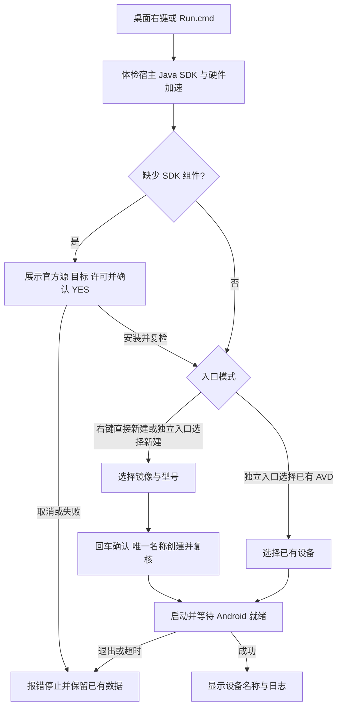

# `JobsAndroidSimulatorCreator`

<!-- jobs-toc:start -->
<!-- jobs-toc:source {"v":2,"token":"[toc]"} -->

📚 目录（点击展开 / 收起）

- [🔥 前言](#%E5%89%8D%E8%A8%80)
- [一、安装与运行前提](#installation)
- [二、创建与启动流程](#workflow)
- [三、安装范围、日志与验证](#boundaries)

<!-- jobs-toc:end -->

---

## 🔥 前言

在 [**Windows**](https://www.microsoft.com/windows) 系统桌面空白右键加入“新建 [**Android**](https://developer.android.com/studio/run/managing-avds) 模拟器”。独立源码目录可以整体复制运行、安装或卸载，并登记到上级组合安装面板。普通文件夹背景、选中文件 / 文件夹和磁盘不出现此入口；Windows 11 使用“显示更多选项”。

| 入口 | 行为 |
| --- | --- |
| `Install.cmd` | 为当前用户构建并注册独立原生菜单。 |
| `Uninstall.cmd` | 只移除此功能菜单，保留 SDK、AVD、日志及备份。 |
| `Run.cmd` | 无须先安装右键菜单，直接进入同一创建 / 启动流程。 |
| `Scripts/CreateAndroidSimulator.ps1 -Check` | 只读检查宿主、Java、SDK 命令行工具及硬件加速，不下载或创建。 |

## 一、安装与运行前提 <a href="#前言" style="font-size:17px; color:green;"><b>🔼</b></a> <a href="#🔚" style="font-size:17px; color:green;"><b>🔽</b></a>

使用系统 [**Windows PowerShell**](https://learn.microsoft.com/powershell/scripting/windows-powershell/overview) `5.1` Desktop、x64 Windows 10 / 11 和图形桌面。原生菜单安装需要已经安装 [**Visual Studio Build Tools**](https://visualstudio.microsoft.com/visual-cpp-build-tools/) 的 MSVC、Windows SDK 和对应宿主架构工具；缺失时在注册前停止，不自动安装编译器。`Run.cmd` 不需要菜单编译器。

Android Emulator 官方目前[不支持 Windows ARM CPU](https://developer.android.com/studio/install#windows)，本包明确停止，避免下载不兼容镜像。x64 使用 `x86_64` 手机 / 平板镜像。BIOS 虚拟化及 [**WHPX**](https://developer.android.com/studio/run/emulator-acceleration) 必须可用；脚本运行 `emulator -accel-check`，失败时给出诊断，不自动改系统功能或安装驱动。

SDK 按 `ANDROID_HOME`、`ANDROID_SDK_ROOT`、当前用户 `LOCALAPPDATA/Android/Sdk` 定位。明确配置的 SDK 优先，损坏时不会切换到另一份。Java 依次检查 `JAVA_HOME`、[**Android Studio**](https://developer.android.com/studio/install) 的 JBR 和 PATH；没有健康 Java 时提供官方安装说明并停止。只对当前进程及其子进程设置 SDK / Java 环境，流程结束后恢复，不改系统代理、全局 PATH 或用户配置。

## 二、创建与启动流程 <a href="#前言" style="font-size:17px; color:green;"><b>🔼</b></a> <a href="#🔚" style="font-size:17px; color:green;"><b>🔽</b></a>

1、从桌面空白右键进入 CMD，显示完整 SDK / Java 来源，检查 `sdkmanager`、`avdmanager`、Emulator、ADB 与硬件加速。

2、桌面右键直接进入新建流程；独立 `Run.cmd` 可以选择“新建 Android 模拟器”或“启动已有 Android 模拟器”。编号列表回车采用第一项，`q` 取消。EOF 会停止，不能被当作默认回车。

3、新建优先选择已安装、匹配宿主的稳定系统镜像，再选择 SDK 自带的设备型号。镜像按 API 从新到旧，Google APIs 优先；兼容 `36.1` 及 `36-extN` 稳定 API，不把代号预览、TV 或其它 CPU 架构混入手机镜像。

4、缺 Command-Line Tools 时，先展示 Google 官方源、SDK 目标及许可链接，必须精确输入 `YES` 才下载。读取官方 `repository2-3.xml`，按其中归档与校验值下载、解压到 SDK 卷内的私有 stage，再同卷重命名至唯一目录；不覆盖现有 Command-Line Tools。现有命令行工具实际执行失败时也可确认安装一个独立新版本，复检仍失败就停止。Emulator / ADB 不只检查文件存在，还实际检查版本；缺失或损坏时确认后由 sdkmanager 修复一次，损坏的已有工具包先卸载再安装，复检仍失败就停止，AVD / 镜像保留。下载失败时被替换的工具可能暂时缺失。没有本机镜像时另行确认；回车不下载。镜像查询、选择和正式安装分开，许可由官方工具交互展示，不自动发送无限 `yes`。

5、最终显示设备、系统镜像、唯一 AVD 名和实际 AVD 目录；直接回车创建并启动，任意非空输入取消。调用 `avdmanager create avd`，不使用 `--force`，名称同时检查现有清单与目录。遵循 `ANDROID_AVD_HOME` / `ANDROID_EMULATOR_HOME` / `ANDROID_USER_HOME`，默认当前用户 `.android/avd`。

6、创建后重新读取 AVD 清单再启动。已有同名且完成启动的 AVD 直接复用；新启动为其分配空闲偶数端口，最长等待 180 秒，同时校验设备名与 `sys.boot_completed=1`，之后才报告就绪。进程退出、工具非零退出或等待超时均报错并保留日志 / AVD，不删除既有设备，也不关闭其它模拟器。

官方当前将 [sdkmanager](https://developer.android.com/tools/sdkmanager) 与 [avdmanager](https://developer.android.com/tools/avdmanager) 标记为弃用，Command-Line Tools 仍提供这两个兼容接口。本包逐次体检后调用 Java 主类，保留 SDK 路径中的中文、空格、`&`、`%` 与单引号，避免 `.bat` / CMD 再次解释；未提供兼容接口时停止并报告，不猜测新版 Android CLI 参数。

## 三、安装范围、日志与验证 <a href="#前言" style="font-size:17px; color:green;"><b>🔼</b></a> <a href="#🔚" style="font-size:17px; color:green;"><b>🔽</b></a>

目录内的脚本、原生桥接与只读运行命令见 [Scripts 说明](./Scripts/README.md)。

安装只写当前用户 `Software/Classes/DesktopBackground/shellex/ContextMenuHandlers/Jobs.WindowsExtension.android-simulator-create` 及本包 CLSID `{9591D98B-3481-4E05-BE24-470FCDFD0E23}`，不写系统级注册表。原生 `IContextMenu` 同时检查无选中项和系统 Desktop 已知目录，菜单生成与点击均复核；SDK / Java 不载入 Explorer 进程。构建完成后才提交注册与状态，失败回滚本包自己的记录。

数据位于当前用户 `LOCALAPPDATA/Jobs/WindowsExtension/extensions/android-simulator-create/`；`logs/` 保存安装记录及每个启动会话的 `.stdout.log` / `.stderr.log`。安装不下载 SDK；实际启动只在运行者确认后补齐缺失组件。卸载保留 SDK、AVD、运行版本、日志和备份，方便排障。

隔离测试位于 [`AndroidSimulatorCreator.Tests.ps1`](../Tests/AndroidSimulatorCreator.Tests.ps1)，覆盖桌面专用注册、单包 release、架构筛选、镜像 / 型号解析、唯一命名、下载门禁、特殊路径、创建与已有设备分支、失败传播及环境恢复。修复和 SDK 同卷 stage 由 [`AndroidSimulatorRepair.Tests.ps1`](../Tests/AndroidSimulatorRepair.Tests.ps1) 的本地归档及进程夹具覆盖；只读体检共用相同健康检查，并明确禁用安装 / 卸载。原生桌面规则另由 [`AndroidDesktopProbe.cpp`](../Tests/AndroidDesktopProbe.cpp) 验证。macOS 上的 PowerShell / C++ 回归不等于 Windows PowerShell 5.1、MSVC 编译、Explorer 加载、真实 SDK 下载与 AVD 启动已经实机通过。

<a id="🔚" href="#前言" style="font-size:17px; color:green; font-weight:bold;">我是有底线的➤点我回到首页</a>
