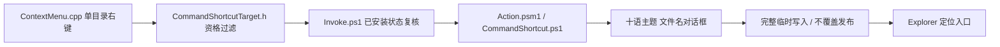
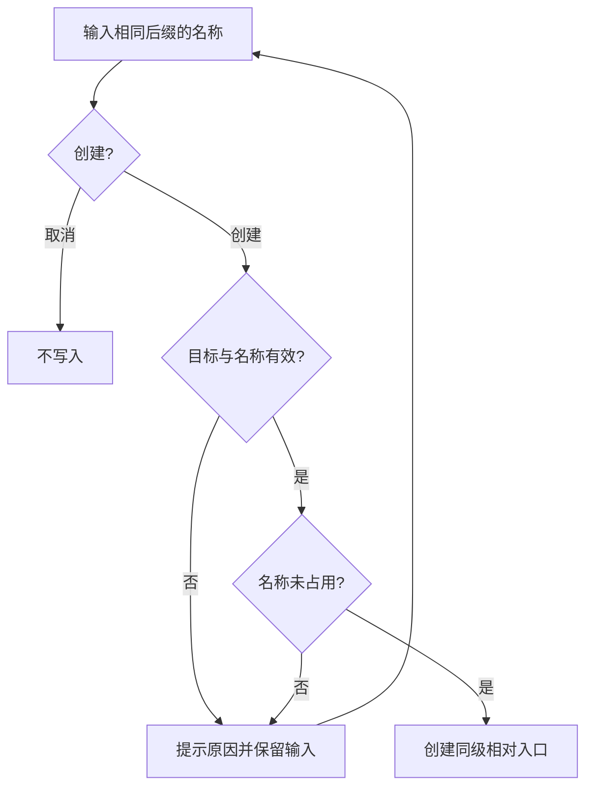

# JobsCommandShortcutCreator · 创建脚本快捷入口


<!-- jobs-toc:start -->
<!-- jobs-toc:source {"v":2,"token":"[toc]"} -->
<details>
<summary>📚 目录（点击展开 / 收起）</summary>

- [🔥 前言](#%E5%89%8D%E8%A8%80)
- [一、操作方式](#usage)
- [二、安装与卸载边界](#management)
- [三、目录结构与执行方式](#implementation)
- [四、验证方式](#validation)

</details>
<!-- jobs-toc:end -->

---

## 🔥 <span id="前言">前言</span>

在 [**Windows 资源管理器**](https://support.microsoft.com/windows) 中，对包含同名普通脚本的 `.cmd`、`.bat` 或 `.ps1` 文件夹右键，选择 **🔗 创建脚本快捷入口…**，在该文件夹旁生成相同格式的相对路径转发脚本。功能由 Jobs 维护，标识为 `command-shortcut-create`，可通过本包或总面板独立安装、更新和卸载。

```text
当前目录/
├── 示例.cmd/
│   ├── 示例.cmd
│   └── README.md
└── 示例（快捷入口）.cmd
```

生成的是普通 `.cmd` / `.bat` / `.ps1` 文本入口，不是 `.lnk`、符号链接或目标脚本副本。它从自身位置定位同级功能包，再传递参数和退出码。创建时不执行目标，不改原脚本内容或权限，也不修改系统执行策略。入口与包一起移动后仍可用；仅移动入口、或给包 / 内部脚本改名，会使配套路径失效。

## 一、<span id="usage">操作方式</span> <a href="#前言" style="font-size:17px; color:green;"><b>🔼</b></a> <a href="#🔚" style="font-size:17px; color:green;"><b>🔽</b></a>

1、双击 [Manage.cmd](./Manage.cmd)，或直接打开 [Manage.vbs](./Manage.vbs)，在 GUI 选择“安装 / 更新”、勾选“创建脚本快捷入口”，点击操作按钮。默认空选，取消、关闭和空选不安装、不卸载。

2、对单个 `.cmd`、`.bat`、`.ps1` 文件夹右键。该目录须真实存在，内部须含完全同名的普通脚本；目录与脚本均不接受重解析点。普通文件、空白处、多选、不合格目录均不显示此项。Windows 11 可能位于“显示更多选项”内。

3、选择 **🔗 创建脚本快捷入口…**，输入与原脚本相同后缀的入口名称，点击“创建”。默认名为 `原名（快捷入口）.后缀`；可改为其它用途名。同级已有原名文件夹，因此入口不能与文件夹同名。

4、成功后资源管理器选中新入口。`.cmd` / `.bat` 可双击执行；`.ps1` 保留 PowerShell 原生运行方式，可在 PowerShell 中调用，实际执行仍遵循当前系统策略。运行时代理保留 PowerShell 通用参数名；若原脚本把 `Verbose`、`Debug`、`ErrorAction` 等通用名称自定义为不同类型，入口会明确报错并停止，不会改写参数后继续执行；可直接运行原脚本。创建不意味着目标业务已执行或成功。

已有同名文件、目录或悬空链接时全部保留，提示换名后可重试。Windows 写入期间持有父目录和脚本包的原生目录句柄并禁止删除共享，避免正常并发重命名改变写入位置；此保护不修改原目录权限。名称须使用原后缀，不接受空白名称、路径分隔符、Windows 保留字符、控制字符、尾部空格 / 句点和保留设备名。取消 / Esc / 关闭不创建文件。先将完整内容写入本目录独占临时文件，再以不覆盖方式移到目标名称，失败清理本次临时文件。

创建对话框与管理面板均支持白天 / 黑夜 / 跟随系统，以及简体中文、繁体中文、藏文、英文、日文、法文、西班牙文、德文、俄罗斯文和韩文；主题及语言共用当前用户面板偏好，切换时保留自定义名称。原生菜单按保存的语言显示，跟随系统时读取当前系统界面语言。

## 二、<span id="management">安装与卸载边界</span> <a href="#前言" style="font-size:17px; color:green;"><b>🔼</b></a> <a href="#🔚" style="font-size:17px; color:green;"><b>🔽</b></a>

运行需要 Windows PowerShell 5.1、系统 .NET / WinForms；安装原生菜单还需要 Visual Studio / Build Tools 的“使用 C++ 的桌面开发”、MSVC 和 Windows SDK，包含 Explorer 对应架构（x86 / x64 / ARM64）的编译工具。缺失时停止注册并提示补齐。业务不依赖 Python、Node.js 或 macOS zsh。

完整保留本包的 `Manage.cmd`、`Manage.vbs`、`Extension.json` 和 `Scripts/` 即可独立复制管理。路径从入口及功能包自身解析，不依赖源码仓库、开发机绝对路径或启动工作目录。管理面板只处理当前 Windows 用户，保持主题、语言、逐项状态、实时日志和安装 / 卸载双向入口；不要求管理员启动整个面板，不改变永久执行策略。

安装将本包运行副本保存到当前用户本地应用数据目录下的 `Jobs/WindowsExtension/command-shortcut-create`，编译对应架构原生菜单 DLL，备份并写入本功能的当前用户注册项。卸载核验所有权后仅移除本功能菜单登记，保留备份、日志、原脚本及已创建的快捷入口。安装后的源码副本可独立运行，源码目录移走不影响已装菜单。

| 对象 | 标识 / 位置 |
| --- | --- |
| 功能 ID | `command-shortcut-create` |
| 原生 CLSID | `{A29030C5-2C96-48BF-BBF2-75D80CC8AF80}` |
| 原生 DLL | 运行副本 `bin/JobsCommandShortcutCreatorContextMenu.dll` |
| 菜单登记 | 当前用户 `Software\Classes\Directory\shellex\ContextMenuHandlers\Jobs.WindowsExtension.command-shortcut-create` |
| 运行副本 / 备份 / 日志 | 当前用户本地应用数据目录下 `Jobs/WindowsExtension/command-shortcut-create` |
| GUI 偏好 | 当前用户本地应用数据目录下 `Jobs/WindowsExtension/panel-preferences.json` |

## 三、<span id="implementation">目录结构与执行方式</span> <a href="#前言" style="font-size:17px; color:green;"><b>🔼</b></a> <a href="#🔚" style="font-size:17px; color:green;"><b>🔽</b></a>

| 文件 / 目录 | 职责 |
| --- | --- |
| [Extension.json](./Extension.json) | 功能标识、名称、目录限制、GUI运行标记和安装器覆盖声明 |
| [Manage.cmd](./Manage.cmd)、[Manage.vbs](./Manage.vbs) | 启动独立 GUI，不承载业务创建 |
| [Scripts](./Scripts/README.md) | 原生菜单、脚本生成、十语主题对话框及管理基础设施 |
| [Tests](./Tests/README.md) | 临时目录行为测试和原生菜单资格过滤测试 |

`.cmd` / `.bat` 入口关闭延迟展开，通过 `%~dp0` 定位目标，避免 `CALL` 的第二次展开；参数以 `%*` 直接尾调用原批处理，不另启第二层 `cmd /c`，由目标脚本结束时返回原始退出码；转交前恢复进入时的控制台代码页。脚本内容使用 UTF-8，运行先切换 UTF-8 代码页；路径中的百分号在源文件中双写，中文、空格、单引号、`!`、`&` 和括号保持为路径内容。运行前通过系统 PowerShell 校验包和脚本仍为普通目标。

`.ps1` 使用 UTF-8 BOM 兼容 Windows PowerShell 5.1，以 `$PSScriptRoot` 和安全单引号引用定位包内脚本，运行时按原脚本参数元数据绑定命名参数、别名、开关和剩余参数；不复制参数默认表达式或验证脚本，原脚本仍负责它们的实际执行。目标显式退出码优先保留，普通失败返回非零。生成器不替用户绕过原脚本运行策略，也不把脚本内容拼入待执行命令。





## 四、<span id="validation">验证方式</span> <a href="#前言" style="font-size:17px; color:green;"><b>🔼</b></a> <a href="#🔚" style="font-size:17px; color:green;"><b>🔽</b></a>

按 [测试说明](./Tests/README.md) 运行临时目录行为及原生资格测试，并用 [参数专项测试](./Tests/NamedParameterTests.ps1/README.md) 核验命名参数、别名、开关、空字符串、剩余参数和保留名称冲突边界，不写注册表、不重启 Explorer，也不执行原始批处理业务。PowerShell 核心逻辑可在兼容 PowerShell 环境隔离验证；MSVC DLL、Explorer 真实菜单、WinForms 十语 / 主题和 `cmd.exe` 参数及代码页行为仍须 Windows 原生核验，不能以 macOS 上的语法或隔离测试代替。

<a id="🔚" href="#前言" style="font-size:17px; color:green; font-weight:bold;">我是有底线的➤点我回到首页</a>
