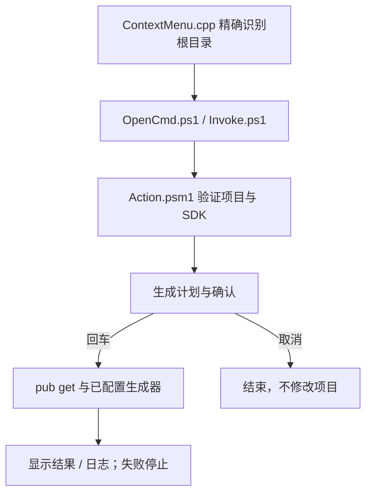

# `JobsFlutterCodegen`


<!-- jobs-toc:start -->
<!-- jobs-toc:source {"v":2,"token":"[toc]"} -->
<details>
<summary>📚 目录（点击展开 / 收起）</summary>

- [🔥 前言](#%E5%89%8D%E8%A8%80)
- [一、安装、卸载与依赖](#installation)
- [二、运行行为与风险](#workflow)
- [三、只读计划、日志与验证](#check-and-logs)

</details>
<!-- jobs-toc:end -->

---

## 🔥 <span id="前言">前言</span>

仅在真实 [**Flutter**](https://flutter.dev/) 根目录提供“Flutter 自动化生产代码”资源管理器右键菜单。每包自包含，可独立复制、安装和卸载；在 CMD 中显示 PowerShell 的执行输出与日志。

| 入口 / 情况 | 实际行为 |
| --- | --- |
| [Install.cmd](./Install.cmd) / [Uninstall.cmd](./Uninstall.cmd) | 本包独立安装 / 卸载，只处理当前用户的本功能菜单。 |
| Flutter 根目录单选或根目录空白处 | 原生 COM 检查同层 `pubspec.yaml` 的 `dependencies.flutter.sdk: flutter`，符合才插入菜单。 |
| 普通目录、项目子目录、文件、多选、网络盘或重解析路径 | 不显示本菜单；点击后再次验证，且不查父目录或扫描子项目。 |
| 已声明 FVM | 优先项目 `.fvm/flutter_sdk`；缺失、不完整或悬空时停止，提示先手动修复，不改用全局 Flutter。 |
| 点击菜单 | 只读生成计划（含 pub get）→ 回车确认 → `flutter pub get` → 已启用生成器；没有可用生成器时经确认仅执行 pub get。 |

## 一、<span id="installation">安装、卸载与依赖</span> <a href="#前言" style="font-size:17px; color:green;"><b>🔼</b></a> <a href="#🔚" style="font-size:17px; color:green;"><b>🔽</b></a>

需要 [**Windows**](https://www.microsoft.com/windows) 10 / 11 图形桌面、系统 [**Windows PowerShell**](https://learn.microsoft.com/powershell/scripting/windows-powershell/overview) 5.1 Desktop 和 .NET。安装动态菜单还需要现有 [**Visual Studio Build Tools**](https://visualstudio.microsoft.com/visual-cpp-build-tools/) 的 C++ 桌面工作负载（MSVC / Windows SDK 与目标架构工具）。缺少时在注册前停止；安装入口不下载编译器、不提权、不更改系统执行策略。

1、双击 `Install.cmd`，查看来源、目标与影响范围，在默认取消的确认窗口选择安装。也可在[总面板](../README.md#installation)仅勾选本功能。

2、安装器先复制本包独立 release、校验哈希并编译原生 DLL，再保存当前用户菜单及状态备份，提交 COM 注册。失败则停止或按事务快照恢复。

3、重新右键 Flutter 根目录。Windows 11 通过“显示更多选项”或 `Shift+F10` 查看经典菜单。

4、双击 `Uninstall.cmd` 只移除本功能的菜单 / CLSID，保留禁用状态、release、日志和备份，其它功能继续保留。

注册范围为当前用户 `HKCU\Software\Classes` 的 `Directory`、`Directory\Background`、`Drive` 三个 `shellex\ContextMenuHandlers` 与本包独立 CLSID。普通目录虽有处理器注册，菜单构建时返回零项；不注册始终可见的静态 verb。

## 二、<span id="workflow">运行行为与风险</span> <a href="#前言" style="font-size:17px; color:green;"><b>🔼</b></a> <a href="#🔚" style="font-size:17px; color:green;"><b>🔽</b></a>

Flutter 与 Dart 使用同一个 SDK 的 `bin`，不会单独搜索其它版本的 Dart。没有 FVM 声明时才使用 PATH Flutter；本功能不安装、升级或切换 SDK。路径作为独立参数和进程环境值传递，CMD 关闭延迟展开；中文、空格、`&`、`%`、`!` 不进入可执行脚本文本。

确认前显示将执行 `pub get` 及各生成命令，说明可能联网、修改 `pubspec.lock`、`.dart_tool` 和项目配置指定的生成文件。真实回车才执行，任意非空输入取消，EOF 停止。build_runner 存在时额外询问是否允许追加 `--delete-conflicting-outputs`，只有精确输入大写 `YES` 才追加，回车不追加。生成器仍可能改写自己管理的产物（新版 build_runner 也会处理手改生成文件），执行前先保存项目修改；未传删除标志不代表所有冲突产物都保留。

| 生成器 | 必须同时满足的启用条件 | 命令 |
| --- | --- | --- |
| build_runner | `dependencies` / `dev_dependencies` 直接声明；生成规则由 annotations / builder 配置提供。 | `dart run build_runner build` |
| flutter_launcher_icons | 直接依赖 + 顶层同名配置或 `flutter_launcher_icons.yaml`。 | `dart run flutter_launcher_icons`；外置文件追加 `-f flutter_launcher_icons.yaml`。 |
| flutter_native_splash | 直接依赖 + 顶层同名配置或 `flutter_native_splash.yaml`。 | `dart run flutter_native_splash:create`；外置文件追加 `--path=flutter_native_splash.yaml`。 |
| l10n | Flutter SDK 依赖 + `flutter.generate: true` + `l10n.yaml` 或 `lib/l10n/*.arb`。 | `flutter gen-l10n` |
| ffigen | 直接依赖 + 顶层 `ffigen` 配置或 `ffigen.yaml`。 | `dart run ffigen`；外置文件追加 `--config ffigen.yaml`。 |
| pigeon | 直接依赖 + `pigeons/messages.dart` 含 `@ConfigurePigeon` 输出配置。 | `dart run pigeon --input pigeons/messages.dart`；不猜输出路径。 |
| protobuf | 直接依赖 `protobuf` + `protos/*.proto`；已有 `protoc` / `protoc-gen-dart`。 | `protoc --dart_out=lib/generated -Iprotos protos/文件.proto`；直接声明 `grpc` 才使用 `grpc:lib/generated`。 |

只支持常见 block / 单行 flow YAML 映射；重复键或无法可靠读取的配置停止，不因存在 `protos/`、`pigeons/` 等目录就运行生成器。缺生成配置明确跳过；已启用的 protoc 缺工具会在 pub get 前停止，不全局激活插件。生成器及目标项目的依赖属于项目自身，不随扩展内嵌；其中 ffigen 仍可能需要系统 LLVM 等工具，失败会停止后续步骤并保留日志。

外部命令输出逐行显示并写入本包日志；URL 凭据 / 查询参数及常见密码字段会脱敏。成功后提示结果；任一步非零退出或超时抛错，菜单入口返回失败，不继续后续步骤。CMD 保持可见以供检查；此任务是前台操作，关闭窗口可能中断。



## 三、<span id="check-and-logs">只读计划、日志与验证</span> <a href="#前言" style="font-size:17px; color:green;"><b>🔼</b></a> <a href="#🔚" style="font-size:17px; color:green;"><b>🔽</b></a>

在本包目录运行只读计划入口，不要求菜单已安装，不调用 Flutter / Dart / protoc，也不获取依赖：

```powershell
powershell.exe `
  -NoProfile `
  -File .\Scripts\Check.ps1 `
  -Target "D:\Flutter项目"
```

运行文件、状态、日志及安装备份保存在当前用户本地应用数据的 `Jobs\WindowsExtension\extensions\flutter-codegen` 下；日志位于 `logs/`，项目路径不会成为日志路径片段。脚本结构和维护入口见 [Scripts/README.md](./Scripts/README.md)。

隔离回归为 [FlutterDoctorCodegen.Tests.ps1](../Tests/FlutterDoctorCodegen.Tests.ps1)，覆盖两包严格根目录识别、FVM 停止、同源 SDK、七类生成计划、确认取消、冲突标志、失败停止、特殊路径传参和独立部署计划。macOS 的 PowerShell 7 逻辑回归不替代 Windows PowerShell 5.1 / MSVC 编译、真实资源管理器菜单与终端显示验收。未执行真实注册、pub get、clean 或项目生成。

<a id="🔚" href="#前言" style="font-size:17px; color:green; font-weight:bold;">我是有底线的➤点我回到首页</a>
