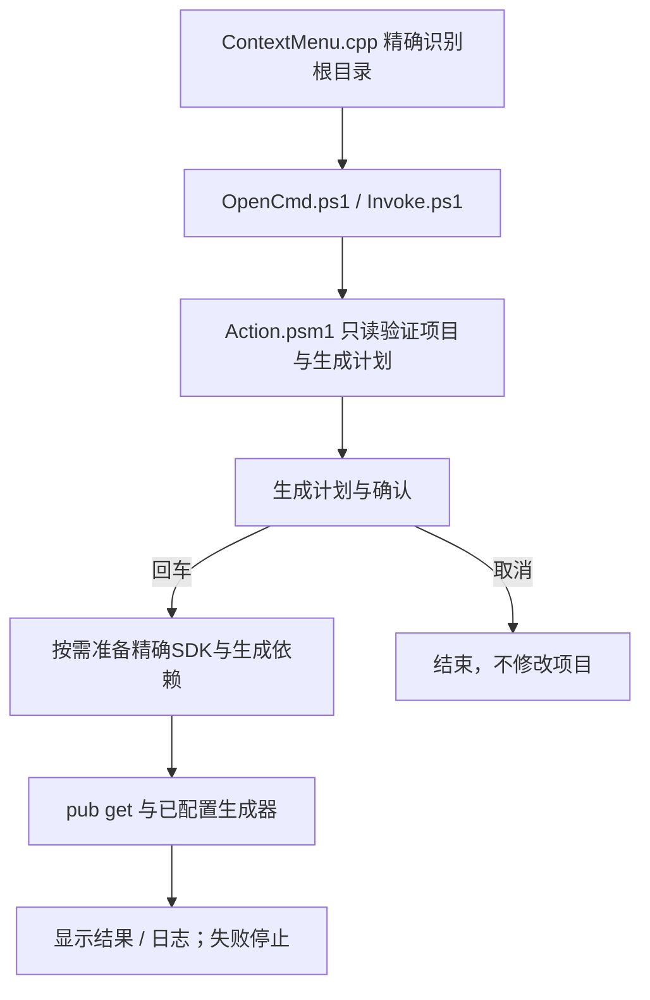

> 当前 `Manage.cmd` 转交同级 [JobsFlutterTools](../JobsFlutterTools/README.md) 安装统一菜单，不能只复制本旧目录新装；`Manage.cmd` 保留旧功能卸载。下文的原生 / 静态菜单实现、状态路径与业务命令是保留源码的说明，当前新安装以统一包及项目 FVM 为准。原“Flutter项目体检”在统一菜单称为“原生Flutter项目体检”。

# `JobsFlutterCodegen`


<!-- jobs-toc:start -->
<!-- jobs-toc:source {"v":2,"token":"[toc]"} -->
<details>
<summary>📚 目录（点击展开 / 收起）</summary>

- [🔥 前言](#%E5%89%8D%E8%A8%80)
- [一、安装、卸载与依赖](#installation)
- [二、运行行为与风险](#workflow)
- [三、只读计划、日志与验证](#check-and-logs)

</details>
<!-- jobs-toc:end -->

---

**管理操作：** 本目录以 `Manage.cmd` 为轻量启动入口，只唤起 GUI 后结束本次脚本；先在面板选择安装 / 更新或卸载。在面板确认安装 / 更新或卸载后立即执行，无二次终端确认。任务开始前关闭或取消面板不会启动操作；卸载保留日志、备份、运行文件和工具。

## 🔥 <span id="前言">前言</span>

**最低支持系统：Windows 10 64 位（x64）。** 这是当前最低支持目标；具体最低 build 尚未锁定，完整实机兼容性仍待验证。最低基线不等于所有功能已经实测通过。

仅在真实 [**Flutter**](https://flutter.dev/) 根目录提供“Flutter 自动化生产代码”资源管理器右键菜单。本目录保留旧业务源码与卸载入口，新安装由统一包承接；在 CMD 中显示 PowerShell 的执行输出与日志。

| 入口 / 情况 | 实际行为 |
| --- | --- |
| [Manage.cmd](./Manage.cmd) / [Manage.cmd](./Manage.cmd) | 安装转交同级 JobsFlutterTools；卸载只处理本旧功能。 |
| Flutter 根目录单选或根目录空白处 | 原生 COM 检查同层 `pubspec.yaml` 的 `dependencies.flutter.sdk: flutter`，符合才插入菜单。 |
| 普通目录、项目子目录、文件、多选、网络盘或重解析路径 | 不显示本菜单；点击后再次验证，且不查父目录或扫描子项目。 |
| 已声明 FVM | 优先项目 `.fvm/flutter_sdk`；明确同意后按精确声明版本准备并复检，不改用全局 Flutter，不重写真实项目绑定。 |
| 点击菜单 | 只读生成计划（含 pub get）→ 回车确认 → 按需准备 SDK／生成依赖 → `flutter pub get` → 已启用生成器；没有可用生成器时经确认仅执行 pub get。 |

**系统兼容性：** 当前目标为 [**Windows**](https://www.microsoft.com/windows) 10 / 11 图形桌面，要求系统 [**Windows PowerShell**](https://learn.microsoft.com/powershell/scripting/windows-powershell/overview) 5.1 Desktop、.NET 与 STA；各系统版本和架构仍待实机验收，未锁定统一最低 build。XP / Vista / Windows 8 不支持当前入口；Windows 7 SP1 / 8.1 即使安装 [**WMF 5.1**](https://www.microsoft.com/en-us/download/details.aspx?id=54616)（要求 .NET Framework 4.5+），也只满足部分运行时前提；本包及当前原生菜单安装不在这两个旧系统的支持范围。Windows 11 使用“显示更多选项”或 `Shift+F10`；x86 / ARM64 均未获全功能实机兼容保证。

**当前入口与依赖：** `Manage.cmd` 转交同级 `JobsFlutterTools` 的统一菜单安装；只复制这个旧目录不能完成新安装，需保留同级完整 `JobsFlutterTools`，或直接复制统一包。`Manage.cmd` 仍用于移除本旧功能。统一包安装需要已有 C++ 桌面工作负载、MSVC / Windows SDK 与系统 .NET Framework C# 编译器；各 SDK / IDE / 生成器的实际系统要求另行满足，旧系统上菜单能显示不能证明业务可运行。


**面板外观与语言：** 总面板和独立功能面板右上角均可选择“黑夜 / 白天 / 跟随系统”以及“简体中文 / 繁體中文 / བོད་ཡིག / English / 日本語 / Français / Español / Deutsch / Русский / 한국어 / 跟随系统”，默认均跟随系统，切换立即生效并保留当前勾选、任务和日志。窄窗或长文案放不下时，工具组移至标题下一行并保持右对齐；极窄窗口将主题、语言分两行，下拉控件右边缘对齐。选择保存在当前用户的 `%LOCALAPPDATA%\Jobs\WindowsExtension\panel-preferences.json`，下次打开自动恢复；保存失败在面板显示原因。跟随系统每秒检查应用主题和当前用户显示语言，繁体中文界面使用繁体、其它中文使用简体，其余已支持语种按系统语言匹配，未支持语言回退英文；Windows 显示语言通常须重新登录才生效。切换涵盖面板正文、功能说明、状态与动态计数、操作提示和辅助名称；藏文优先使用已安装 Microsoft Himalaya / Noto Sans Tibetan，日韩使用对应系统字体，缺失时回退。语言名称始终显示自称，图标、功能名和状态列独立，长文字换行；切换只影响管理面板，已安装右键菜单标题及后台工具的原始日志保持各自语言。共享完整译文以 `Scripts/ManagerPanelTranslations.json` 为编辑来源，发布时内嵌到同源面板模块，独立包无需访问兄弟目录或联网翻译。

**管理面板关闭：** 空闲关闭时选择退到系统托盘或完全退出，默认回车为托盘、Esc 保留原窗；安装／卸载／构建清理进行中关闭直接后台，不询问、不终止任务。完工仍驻留，从托盘双击或“显示管理面板”恢复同一窗口；忙碌时不能完全退出。

**整行选择：** 点击复选框、图标、功能文字、普通状态区或该功能行空白，仅切换该项一次，保留原 Tab／Space 复选框操作及勾选事件。任务执行中及不可用项禁止切换；失败日志链接和独立按钮优先执行自身动作，不连带勾选。组标题拖动、分组按钮和组尾空白不算功能行；移动、离开、滚动或触控滑动会取消本次点击候选，不接管原生滚动。选择本身不执行安装、卸载或清理，原默认空选、主题／语言切换保留勾选及持久化规则不变。

**两种部署路线：** 源码管理面板默认使用“默认程序安装位置”，运行文件仍位于 `%LOCALAPPDATA%\Jobs\WindowsExtension\extensions\<功能ID>`。也可切换到“本地临时构建目录”，运行文件位于 `<功能包>\work\WindowsExtension\extensions\<功能ID>`；移走或清除该运行目录会使菜单失效。已部署副本的管理入口固定到自身真实路线，切换路线请从源码管理入口操作。菜单命令与 `deployment.json` 按当前路线定位配置，不依赖面板环境变量；提交失败恢复两侧状态。

**构建产物清理：** 安装位置选择、显示中的自动清理复选框与红色“🧹 清除构建产物”按钮排在同一行，垂直居中、间隔统一。英文或窄窗空间不足时，该行可水平滚动，文字保持完整，不拆成两行。仅默认安装位置路线显示默认关闭的“安装成功后清除此轮构建产物”和红底白字的“🧹 清除构建产物”独立按钮。自动清理仅处理本次成功安装产生的编译 GUID 子目录；独立按钮按当前选择清理本包 `work\JobsExtensionBuild` 专用编译工作区，不需要重新安装。临时路线隐藏清理控件。清理验证运行文件、标记与路径边界并持有事务锁，保留已经安装的 `.exe`、`.dll`、`.cmd`、`.ps1`、配置和注册表；自动清理失败明确显示“安装成功，清理失败”，独立清理失败正常报错。

**停止安装：** 安装进行中原按钮变为“停止安装”。点击只写停止请求，等待当前包事务完整结束，再把后续包标记为“未执行”；不强杀安装器、编译进程或资源管理器，未执行项不计失败或完成百分比。完成后可在同一面板继续清理、重试或关闭。

## 一、<span id="installation">安装、卸载与依赖</span> <a href="#前言" style="font-size:17px; color:green;"><b>🔼</b></a> <a href="#🔚" style="font-size:17px; color:green;"><b>🔽</b></a>

需要 [**Windows**](https://www.microsoft.com/windows) 10 / 11 图形桌面、系统 [**Windows PowerShell**](https://learn.microsoft.com/powershell/scripting/windows-powershell/overview) 5.1 Desktop 和 .NET。安装动态菜单还需要现有 [**Visual Studio Build Tools**](https://visualstudio.microsoft.com/visual-cpp-build-tools/) 的 C++ 桌面工作负载（MSVC / Windows SDK 与目标架构工具）。缺少时在注册前停止；安装入口不下载编译器、不提权、不更改系统执行策略。

1、新安装保留同级 `JobsFlutterTools`，双击 `Manage.cmd` 转交统一包，或在[总面板](../README.md#installation)选择统一 Flutter 工具组。以下逐包 release / COM 事务说明对应保留的旧安装实现；本目录 `Manage.cmd` 仍只卸载旧功能。

2、安装器先复制本包独立 release、校验哈希并编译原生 DLL，再保存当前用户菜单及状态备份，提交 COM 注册。失败则停止或按事务快照恢复。

3、重新右键 Flutter 根目录。Windows 11 通过“显示更多选项”或 `Shift+F10` 查看经典菜单。

4、双击 `Manage.cmd` 只移除本功能的菜单 / CLSID，保留禁用状态、release、日志和备份，其它功能继续保留。

注册范围为当前用户 `HKCU\Software\Classes` 的 `Directory`、`Directory\Background`、`Drive` 三个 `shellex\ContextMenuHandlers` 与本包独立 CLSID。普通目录虽有处理器注册，菜单构建时返回零项；不注册始终可见的静态 verb。

## 二、<span id="workflow">运行行为与风险</span> <a href="#前言" style="font-size:17px; color:green;"><b>🔼</b></a> <a href="#🔚" style="font-size:17px; color:green;"><b>🔽</b></a>

Flutter 与 Dart 使用同一个 SDK 的 `bin`，不会单独搜索其它版本的 Dart。没有 FVM 声明时才使用 PATH Flutter；本功能只在确认后准备本项目已声明的精确版本，不升级、切换或重写项目绑定。路径作为独立参数和进程环境值传递，CMD 关闭延迟展开；中文、空格、`&`、`%`、`!` 不进入可执行脚本文本。

确认前显示将执行 `pub get` 及各生成命令，说明可能联网、修改 `pubspec.lock`、`.dart_tool` 和项目配置指定的生成文件。真实回车才执行，任意非空输入取消，EOF 停止。build_runner 存在时额外询问是否允许追加 `--delete-conflicting-outputs`，只有精确输入大写 `YES` 才追加，回车不追加。生成器仍可能改写自己管理的产物（新版 build_runner 也会处理手改生成文件），执行前先保存项目修改；未传删除标志不代表所有冲突产物都保留。

| 生成器 | 必须同时满足的启用条件 | 命令 |
| --- | --- | --- |
| build_runner | `dependencies` / `dev_dependencies` 直接声明；生成规则由 annotations / builder 配置提供。 | `dart run build_runner build` |
| flutter_launcher_icons | 直接依赖 + 顶层同名配置或 `flutter_launcher_icons.yaml`。 | `dart run flutter_launcher_icons`；外置文件追加 `-f flutter_launcher_icons.yaml`。 |
| flutter_native_splash | 直接依赖 + 顶层同名配置或 `flutter_native_splash.yaml`。 | `dart run flutter_native_splash:create`；外置文件追加 `--path=flutter_native_splash.yaml`。 |
| l10n | Flutter SDK 依赖 + `flutter.generate: true` + `l10n.yaml` 或 `lib/l10n/*.arb`。 | `flutter gen-l10n` |
| ffigen | 直接依赖 + 顶层 `ffigen` 配置或 `ffigen.yaml`。 | `dart run ffigen`；外置文件追加 `--config ffigen.yaml`。 |
| pigeon | 直接依赖 + `pigeons/messages.dart` 含 `@ConfigurePigeon` 输出配置。 | `dart run pigeon --input pigeons/messages.dart`；不猜输出路径。 |
| protobuf | 直接依赖 `protobuf` + `protos/*.proto`；确认后按需准备 protoc 与私有 Dart 插件。 | `protoc --dart_out=lib/generated -Iprotos protos/文件.proto`；直接声明 `grpc` 才使用 `grpc:lib/generated`。 |

只支持常见 block / 单行 flow YAML 映射；重复键或无法可靠读取的配置停止，不因存在 `protos/`、`pigeons/` 等目录就运行生成器。缺生成配置明确跳过；已启用的 protoc 缺工具会在确认后的当前流程准备，插件仅激活到本包私有缓存。生成器及目标项目的依赖属于项目自身，不随扩展内嵌；其中 ffigen 仍可能需要系统 LLVM 等工具，失败会停止后续步骤并保留日志。

外部命令输出逐行显示并写入本包日志；URL 凭据 / 查询参数及常见密码字段会脱敏。成功后提示结果；任一步非零退出或超时抛错，菜单入口返回失败，不继续后续步骤。CMD 保持可见以供检查；此任务是前台操作，关闭窗口可能中断。



## 三、<span id="check-and-logs">只读计划、日志与验证</span> <a href="#前言" style="font-size:17px; color:green;"><b>🔼</b></a> <a href="#🔚" style="font-size:17px; color:green;"><b>🔽</b></a>

在本包目录运行只读计划入口，不要求菜单已安装，不调用 Flutter / Dart / protoc，也不获取依赖：

```powershell
powershell.exe `
  -NoProfile `
  -File Scripts\Check.ps1\Check.ps1 `
  -Target "D:\Flutter项目"
```

运行文件、状态、日志及安装备份保存在当前用户本地应用数据的 `Jobs\WindowsExtension\extensions\flutter-codegen` 下；日志位于 `logs/`，项目路径不会成为日志路径片段。脚本结构和维护入口见 [Scripts/README.md](./Scripts/README.md)。

隔离回归为 [FlutterDoctorCodegen.Tests.ps1](../Tests/FlutterDoctorCodegen.Tests.ps1/FlutterDoctorCodegen.Tests.ps1)，覆盖两包严格根目录识别、FVM 停止、同源 SDK、七类生成计划、确认取消、冲突标志、失败停止、特殊路径传参和独立部署计划。macOS 的 PowerShell 7 逻辑回归不替代 Windows PowerShell 5.1 / MSVC 编译、真实资源管理器菜单与终端显示验收。未执行真实注册、pub get、clean 或项目生成。

管理安装 / 卸载时双击 `Manage.cmd`，它只通过 WScript 唤起 GUI，随后立即结束本次脚本；不在 CMD 中编译、安装或等待输入。也可直接双击 `Manage.vbs/Manage.vbs` 进入同一面板。每个选项显示等待、执行中、完成或失败，底部实时滚动标准输出和错误，可选中复制或点击“复制全部日志”；无可靠百分比时显示执行中，总体显示完成项数。运行期间等当前事务结束后关闭，完整管理日志位于系统临时目录 `JobsExtensionManager-<运行编号>.log`。

**SDK 环境准备：** 已选择的 SDK／版本所需下载、安装及首次 Flutter／Dart 缓存补齐自动执行；网络失败或无进度超时后持续重试，间隔逐步增加并封顶 30 秒，没有次数和总时长上限，直到成功或本人 Ctrl+C／停止。仍在输出下载进度的传输不按总时长截断；成功后才进入后续业务。目标／版本选择、官方许可证与系统权限仍由本人处理；路径、权限、磁盘或明确不存在的版本会报告具体原因。每次尝试和真实进度追加到终端所示日志；同一 URL 有 ETag／Last-Modified 时安全续传，跨来源保留独立临时文件，不拼接不同来源。失败／取消保留下载现场；业务构建和配置写入不因网络重试而整体重放。


<!-- JOBS_SOURCE_SCRIPT_PACKAGES -->
**同名脚本包：** [Manage.vbs](./Manage.vbs/README.md)。源码路径与发布目录的 flat 资源名分开维护。
<!-- /JOBS_SOURCE_SCRIPT_PACKAGES -->

**代码生成必需依赖：** 计划与确认前只读，取消不准备 SDK 或生成工具。明确同意后复用所选项目 Flutter 与同源 Dart；精确 FVM 版本缺失时，Git／FVM 按需准备，FVM 官方独立 ZIP 核对发布摘要，在私有影子项目获取该版本并复检来源、缓存和真实配置 SHA，不执行 `fvm use` 或改写项目绑定。健康 custom SDK 保留；缺 SDK 又没有精确版本、未知 fork／channel 或来源冲突时要求先明确配置，不猜测任意最新版。只有计划确实包含 Protobuf 才准备当前用户 `Google.Protobuf` 和所选 Dart 的私有 `PUB_CACHE` 中的 `protoc_plugin`，通过明确 `--plugin` 路径及子进程环境使用，不覆盖全局插件／缓存。原生许可、系统权限仍由本人处理；网络失败沿当前流程重试，确定阻塞停止。Doctor 仍为只读检查，不因此安装工具。

<a id="🔚" href="#前言" style="font-size:17px; color:green; font-weight:bold;">我是有底线的➤点我回到首页</a>
