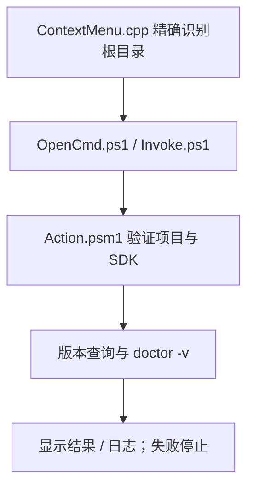

> 当前 `Manage.cmd` 转交同级 [JobsFlutterTools](../JobsFlutterTools/README.md) 安装统一菜单，不能只复制本旧目录新装；`Manage.cmd` 保留旧功能卸载。下文的原生 / 静态菜单实现、状态路径与业务命令是保留源码的说明，当前新安装以统一包及项目 FVM 为准。原“Flutter项目体检”在统一菜单称为“原生Flutter项目体检”。

# `JobsFlutterDoctor`


<!-- jobs-toc:start -->
<!-- jobs-toc:source {"v":2,"token":"[toc]"} -->
<details>
<summary>📚 目录（点击展开 / 收起）</summary>

- [🔥 前言](#%E5%89%8D%E8%A8%80)
- [一、安装、卸载与依赖](#installation)
- [二、运行行为与风险](#workflow)
- [三、只读计划、日志与验证](#check-and-logs)

</details>
<!-- jobs-toc:end -->

---

**管理操作：** 本目录以 `Manage.cmd` 为轻量启动入口，只唤起 GUI 后结束本次脚本；先在面板选择安装 / 更新或卸载。在面板确认安装 / 更新或卸载后立即执行，无二次终端确认。关闭或取消面板不执行；卸载保留日志、备份、运行文件和工具。

## 🔥 <span id="前言">前言</span>

**最低支持系统：Windows 10 64 位（x64）。** 这是当前最低支持目标；具体最低 build 尚未锁定，完整实机兼容性仍待验证。最低基线不等于所有功能已经实测通过。

仅在真实 [**Flutter**](https://flutter.dev/) 根目录提供“Flutter 项目体检”资源管理器右键菜单。本目录保留旧业务源码与卸载入口，新安装由统一包承接；在 CMD 中显示 PowerShell 的执行输出与日志。

| 入口 / 情况 | 实际行为 |
| --- | --- |
| [Manage.cmd](./Manage.cmd) / [Manage.cmd](./Manage.cmd) | 安装转交同级 JobsFlutterTools；卸载只处理本旧功能。 |
| Flutter 根目录单选或根目录空白处 | 原生 COM 检查同层 `pubspec.yaml` 的 `dependencies.flutter.sdk: flutter`，符合才插入菜单。 |
| 普通目录、项目子目录、文件、多选、网络盘或重解析路径 | 不显示本菜单；点击后再次验证，且不查父目录或扫描子项目。 |
| 已声明 FVM | 优先项目 `.fvm/flutter_sdk`；缺失、不完整或悬空时停止，提示先手动修复，不改用全局 Flutter。 |
| 点击菜单 | 同源 Flutter / Dart 校验 → `flutter --version` → `flutter doctor -v`；命令失败或 doctor 报未通过检查即停止。 |

**系统兼容性：** 当前目标为 [**Windows**](https://www.microsoft.com/windows) 10 / 11 图形桌面，要求系统 [**Windows PowerShell**](https://learn.microsoft.com/powershell/scripting/windows-powershell/overview) 5.1 Desktop、.NET 与 STA；各系统版本和架构仍待实机验收，未锁定统一最低 build。XP / Vista / Windows 8 不支持当前入口；Windows 7 SP1 / 8.1 即使安装 [**WMF 5.1**](https://www.microsoft.com/en-us/download/details.aspx?id=54616)（要求 .NET Framework 4.5+），也只满足部分运行时前提；本包及当前原生菜单安装不在这两个旧系统的支持范围。Windows 11 使用“显示更多选项”或 `Shift+F10`；x86 / ARM64 均未获全功能实机兼容保证。

**当前入口与依赖：** `Manage.cmd` 转交同级 `JobsFlutterTools` 的统一菜单安装；只复制这个旧目录不能完成新安装，需保留同级完整 `JobsFlutterTools`，或直接复制统一包。`Manage.cmd` 仍用于移除本旧功能。统一包安装需要已有 C++ 桌面工作负载、MSVC / Windows SDK 与系统 .NET Framework C# 编译器；各 SDK / IDE / 生成器的实际系统要求另行满足，旧系统上菜单能显示不能证明业务可运行。

## 一、<span id="installation">安装、卸载与依赖</span> <a href="#前言" style="font-size:17px; color:green;"><b>🔼</b></a> <a href="#🔚" style="font-size:17px; color:green;"><b>🔽</b></a>

需要 [**Windows**](https://www.microsoft.com/windows) 10 / 11 图形桌面、系统 [**Windows PowerShell**](https://learn.microsoft.com/powershell/scripting/windows-powershell/overview) 5.1 Desktop 和 .NET。安装动态菜单还需要现有 [**Visual Studio Build Tools**](https://visualstudio.microsoft.com/visual-cpp-build-tools/) 的 C++ 桌面工作负载（MSVC / Windows SDK 与目标架构工具）。缺少时在注册前停止；安装入口不下载编译器、不提权、不更改系统执行策略。

1、新安装保留同级 `JobsFlutterTools`，双击 `Manage.cmd` 转交统一包，或在[总面板](../README.md#installation)选择统一 Flutter 工具组。以下逐包 release / COM 事务说明对应保留的旧安装实现；本目录 `Manage.cmd` 仍只卸载旧功能。

2、安装器先复制本包独立 release、校验哈希并编译原生 DLL，再保存当前用户菜单及状态备份，提交 COM 注册。失败则停止或按事务快照恢复。

3、重新右键 Flutter 根目录。Windows 11 通过“显示更多选项”或 `Shift+F10` 查看经典菜单。

4、双击 `Manage.cmd` 只移除本功能的菜单 / CLSID，保留禁用状态、release、日志和备份，其它功能继续保留。

注册范围为当前用户 `HKCU\Software\Classes` 的 `Directory`、`Directory\Background`、`Drive` 三个 `shellex\ContextMenuHandlers` 与本包独立 CLSID。普通目录虽有处理器注册，菜单构建时返回零项；不注册始终可见的静态 verb。

## 二、<span id="workflow">运行行为与风险</span> <a href="#前言" style="font-size:17px; color:green;"><b>🔼</b></a> <a href="#🔚" style="font-size:17px; color:green;"><b>🔽</b></a>

Flutter 与 Dart 使用同一个 SDK 的 `bin`，不会单独搜索其它版本的 Dart。没有 FVM 声明时才使用 PATH Flutter；本功能不安装、升级或切换 SDK。路径作为独立参数和进程环境值传递，CMD 关闭延迟展开；中文、空格、`&`、`%`、`!` 不进入可执行脚本文本。

体检执行 `flutter --version` 与 `flutter doctor -v`，显示当前版本和缺失的开发组件。不执行 `clean`、`pub get`、分析修复或工具升级，不主动修改项目。Flutter 自身可能检查网络、访问设备并更新 SDK 缓存；因此“只读”指本包不改项目与安装配置，并非禁止 Flutter 自身的缓存行为。

外部命令输出逐行显示并写入本包日志；URL 凭据 / 查询参数及常见密码字段会脱敏。成功后提示结果；doctor 出现 `[!]` / `[✗]` / `Doctor found issues` 时，即使工具退出 0 也返回失败；任一步非零退出或超时抛错，菜单入口返回失败，不继续后续步骤。CMD 保持可见以供检查；此任务是前台操作，关闭窗口可能中断。



## 三、<span id="check-and-logs">只读计划、日志与验证</span> <a href="#前言" style="font-size:17px; color:green;"><b>🔼</b></a> <a href="#🔚" style="font-size:17px; color:green;"><b>🔽</b></a>

在本包目录运行只读计划入口，不要求菜单已安装，不调用 Flutter / Dart / protoc，也不获取依赖：

```powershell
powershell.exe `
  -NoProfile `
  -File .\Scripts\Check.ps1 `
  -Target "D:\Flutter项目"
```

运行文件、状态、日志及安装备份保存在当前用户本地应用数据的 `Jobs\WindowsExtension\extensions\flutter-doctor` 下；日志位于 `logs/`，项目路径不会成为日志路径片段。脚本结构和维护入口见 [Scripts/README.md](./Scripts/README.md)。

隔离回归为 [FlutterDoctorCodegen.Tests.ps1](../Tests/FlutterDoctorCodegen.Tests.ps1)，覆盖两包严格根目录识别、FVM 停止、同源 SDK、七类生成计划、确认取消、冲突标志、失败停止、特殊路径传参和独立部署计划。macOS 的 PowerShell 7 逻辑回归不替代 Windows PowerShell 5.1 / MSVC 编译、真实资源管理器菜单与终端显示验收。未执行真实注册、pub get、clean 或项目生成。

管理安装 / 卸载时双击 `Manage.cmd`，它只通过 WScript 唤起 GUI，随后立即结束本次脚本；不在 CMD 中编译、安装或等待输入。也可直接双击 `Manage.vbs` 进入同一面板。每个选项显示等待、执行中、完成或失败，底部实时滚动标准输出和错误，可选中复制或点击“复制全部日志”；无可靠百分比时显示执行中，总体显示完成项数。运行期间等当前事务结束后关闭，完整管理日志位于系统临时目录 `JobsExtensionManager-<运行编号>.log`。

<a id="🔚" href="#前言" style="font-size:17px; color:green; font-weight:bold;">我是有底线的➤点我回到首页</a>
