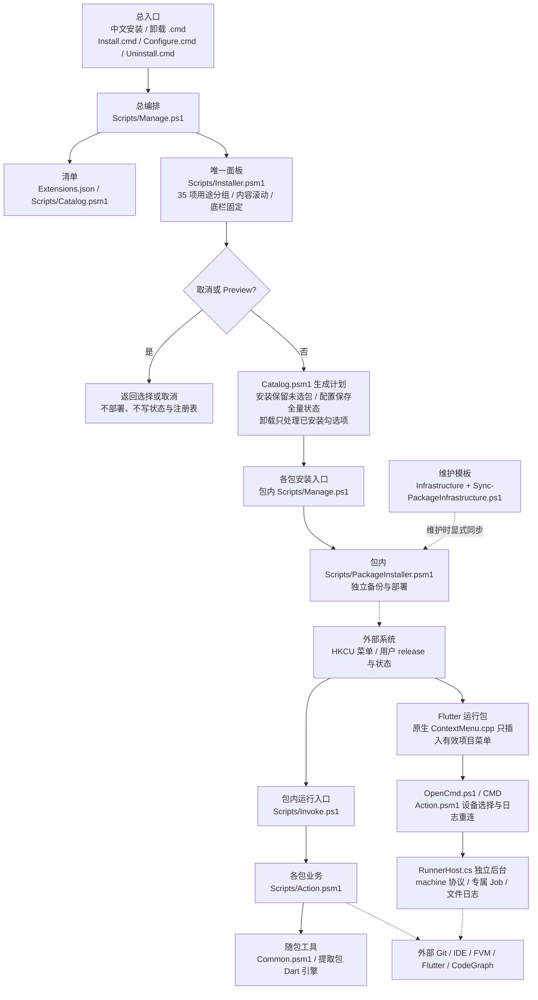
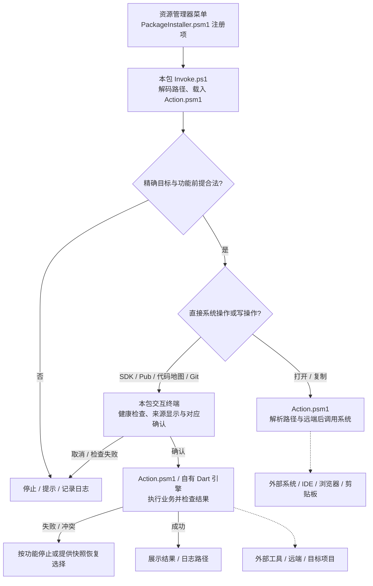
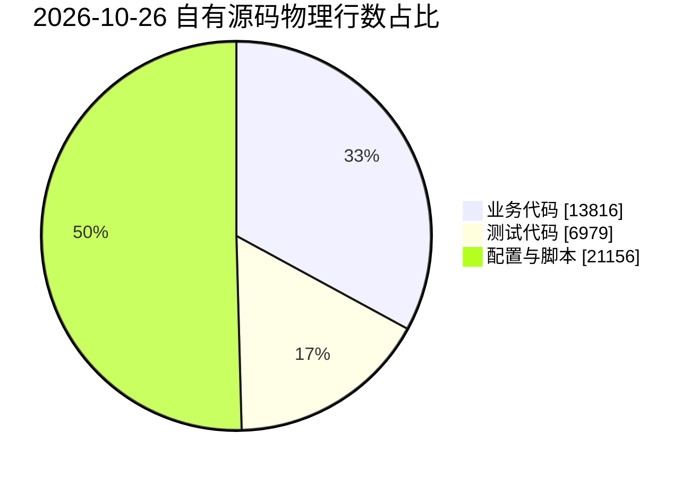

> Flutter 菜单由 [JobsFlutterTools](JobsFlutterTools/README.md)：固定顺序的“Flutter开发相关辅助工具”和“Flutter项目修复”，包含“安装/切换 Flutter@OpenHarmony SDK”、原生/Harmony 双层体检、清理维护及三项修复。OpenHarmony 版从 CPF-Flutter tag 选择、锁定 commit，并通过独立缓存绑定当前项目 FVM；Java 安装/切换菜单目前在 macOS 提供。旧 Flutter 单项安装入口转到统一包，全部使用项目 FVM。详细菜单、显示条件与执行边界见功能说明。

# `WindowsOS@Extension`


<!-- jobs-toc:start -->
<!-- jobs-toc:source {"v":2,"token":"[toc]"} -->
<details>
<summary>📚 目录（点击展开 / 收起）</summary>

- [🔥 前言](#%E5%89%8D%E8%A8%80)
- [一、功能对照](#features)
- [二、安装、配置与卸载](#installation)
  - [【Windows】🧩安装资源管理器扩展.cmd](#install)
  - [Install.cmd](#install-compat)
  - [Configure.cmd](#configure)
  - [【Windows】🧩卸载资源管理器扩展.cmd](#uninstall)
  - [Uninstall.cmd](#uninstall-compat)
- [三、目录结构与安装状态](#structure)
  - [Sync-PackageInfrastructure.ps1](#sync-package-infrastructure)
- [四、命令执行与失败处理](#behavior)
- [五、验证与验收](#verification)
- [六、README 自动折叠目录](#markdown-toc)
  - [MarkdownToc.mjs 兼容入口](#markdown-toc-tool)
- [七、项目统计与复核口径](#project-statistics)
  - [7.1、工具链与锁文件](#jobs-toc-heading-16)
  - [7.2、源码与部署管理](#jobs-toc-heading-17)
  - [7.3、界面、功能与后端规模](#jobs-toc-heading-18)
  - [7.4、模块依赖与核心流程](#jobs-toc-heading-19)
  - [7.5、功能实现清单](#jobs-toc-heading-20)
  - [7.6、业务代码占比](#jobs-toc-heading-21)
- [八、直接依赖与风险](#direct-dependencies)
- [九、运行环境与常见问题补充](#runtime-environments)

</details>
<!-- jobs-toc:end -->

---

## 🔥 <span id="前言">前言</span>

**最低支持系统：Windows 10 64 位（x64）。** 这是当前最低支持目标；具体最低 build 尚未锁定，完整实机兼容性仍待验证。最低基线不等于所有功能已经实测通过。

**项目定位：** 面向 Windows 开发人员的独立右键功能包集合。**状态：维护中，Windows 桌面验收待完成**；负责人 **Jobs** / [**JobsKits**](https://github.com/JobsKits)，未登记其他维护团队。功能数核验于 **2026-10-26**，本地验证基线见验证章节；统计章其余数据保留各自注明的日期。

为 [**Windows**](https://www.microsoft.com/windows) 开发人员提供资源管理器右键菜单，与同级 [`MacOS@Extension`](../MacOS@Extension/README.md) 对齐日常开发操作。当前保留 **30 个功能源码目录**，其中八个旧 Flutter 包保留兼容源码与入口；根清单登记 **22 个现行安装包**，提供 **35 项复选框组合安装面板**（其中 Flutter 展开为 14 项子功能）。现行包各自包含源码、安装、卸载和运行模块，可以只复制其中一个包使用。使用系统自带的 [**Windows PowerShell**](https://learn.microsoft.com/powershell/scripting/windows-powershell/overview) `5.1`，不需要管理员权限；Flutter 运行、打包、环境诊断、代码生成、Android / Harmony 模拟器、单文件运行权限、隐藏文件、[**Sourcetree**](https://www.sourcetreeapp.com/) 打开及 Android Studio / VSCode 菜单安装时需要现有 MSVC / Windows SDK 编译原生桥接，其它包直接部署脚本。

<strong id="windows-compatibility">Windows 版本、架构与测试边界</strong>

**当前以 Windows 10 / 11 图形桌面为目标，仍待真实 Windows 桌面逐项验收；不能将系统版本名称、PowerShell 语法 / CI 通过或菜单注册成功理解为全功能兼容。** 安装入口要求系统 Windows PowerShell 5.1 Desktop、STA 与系统 .NET / WinForms，PowerShell 7 不能替代这些入口。

| 系统 | 当前适用范围 |
| --- | --- |
| Windows XP / Vista / 8 | 不支持当前入口；微软没有为这些客户端系统提供 WMF 5.1。兼容模式不能补齐所需运行时。 |
| Windows 7 SP1 / 8.1 | 可按微软要求补装 WMF 5.1 与 .NET Framework 4.5+，但仅列为基础静态菜单的探索性测试，尚不属于本仓支持范围；原生菜单、IDE / SDK 与联网业务不随之获得支持。 |
| Windows 10 | 当前目标系统，要求实际存在 Windows PowerShell 5.1 Desktop；5.1 从 1607 起内置，这一运行时起点不构成全部功能的最低 build 承诺。不同 build、x86 / x64 与外部工具版本须分别验收。 |
| Windows 11 | 当前目标系统；本仓菜单位于“显示更多选项”，也可按 `Shift+F10`。x64 / ARM64 须分别验收，ARM64 不代表可运行所有模拟器或原生工具。 |

旧系统运行时依据：[微软 WMF 适用系统表](https://learn.microsoft.com/powershell/scripting/windows-powershell/wmf/setup/install-configure?view=powershell-5.1)及 [WMF 5.1 下载与 .NET 前提](https://www.microsoft.com/en-us/download/details.aspx?id=54616)。能安装该运行时只说明具备部分入口前提，不证明本仓应用兼容。

- **基础静态菜单：** 路径 / Git / Visual Studio / 终端等普通包直接部署脚本，无须 MSVC；菜单动作仍要求各自可用的 Git、IDE、浏览器或剪贴板。
- **原生菜单：** 现行 JobsFlutterTools、Git 提交回退、Android / Harmony 模拟器、单文件权限、隐藏文件、Android Studio / VSCode 包安装需要已有 Visual Studio / Build Tools 的“使用 C++ 的桌面开发”、MSVC、Windows SDK 和与 Explorer 一致的架构工具；Flutter 后台运行另需系统 .NET Framework 的 `csc.exe`。缺少时在注册前停止，不会自动安装编译器。
- **CPU 架构：** 原生构建有 x64 / ARM64 / x86 分支，但尚无完整实机兼容保证；纯 32 位 Windows 的 `ProgramFiles(x86)` 工具定位存在风险。部分业务（如 CodeGraph）仅提供 x64 / ARM64，Android / Harmony 本地模拟器仅面向 AMD64（x64），不得用 x86 分支或 ARM64 虚拟机菜单通过推定全功能可用。
- **虚拟机与物理机：** 虚拟机适合验证菜单安装 / 卸载、显示条件、参数传递及实际 EXE / 工具启动；Android Emulator 的加速、AVD 启动与扩容需在符合官方要求的 AMD64 物理机单独验收，虚拟机 / 嵌套虚拟化不作为支持结论。Harmony 本地模拟器官方不支持虚拟机、Windows ARM 或 32 位宿主，须使用符合要求的 AMD64 Windows 10 / 11 物理机。见 [Android 环境要求](https://developer.android.com/studio/install#windows)、[Android 加速要求](https://developer.android.com/studio/run/emulator-acceleration)与 [Harmony 环境要求](https://developer.huawei.com/consumer/cn/doc/harmonyos-guides/ide-emulator-requirements)。
- **外部工具与最低 build：** Flutter / Dart / FVM、Node / WinGet、Java、Android Studio、DevEco 等各版本可能提高系统、build 或 CPU 下限。本仓尚未锁定全套依赖和原生编译工具版本，也未统一强制最低 Windows build；应记录目标系统 build、CPU、工具版本及测试结果，按更高要求判断具体功能。
- **旧 Flutter 包：** 八个旧目录保留源码与卸载入口，当前 `Install.cmd` 转交同级 `JobsFlutterTools`；不能只复制旧目录进行新安装。可独立交付统一包，或保留完整仓目录。各功能 README 中的旧实现描述不代替当前入口说明。

右键菜单的功能文字统一带语义 emoji 前缀，例如“📋 复制绝对路径”“🔓 运行授权”“📦 Flutter打包”；同一功能在独立包和聚合菜单保持同一图形，不同功能使用不同图形。已有安装需重新安装 / 更新对应包后读取新标题。

**快速开始：** 将整个 `WindowsOS@Extension` 文件夹复制到 Windows，双击 [`【Windows】🧩安装资源管理器扩展.cmd`](./【Windows】🧩安装资源管理器扩展.cmd)，在原生复选框窗口选择功能后点击“安装”。卸载使用配套的 [`【Windows】🧩卸载资源管理器扩展.cmd`](./【Windows】🧩卸载资源管理器扩展.cmd)；原 `Install.cmd` / `Uninstall.cmd` 继续兼容。只需一项功能时，也可单独复制对应现行包，双击包内 `Install.cmd`；例如 [`JobsPathCopier/Install.cmd`](./JobsPathCopier/Install.cmd) 只安装复制绝对路径。重新右键文件、文件夹、磁盘或文件夹空白处即可；**Windows 11 需要点击“显示更多选项”**，也可使用 `Shift+F10` 打开经典菜单。

| 操作 | 实际结果 |
| --- | --- |
| 右键 `D:\项目\Demo` → 复制绝对路径 | 剪贴板得到 `D:\项目\Demo`，无额外引号。 |
| 右键源文件 → 用终端打开 | 在源文件的父目录启动终端。 |
| 安装面板只勾选其中几项 | 只安装或更新勾选项；Flutter 组按本次选择精确替换，整个 Flutter 组未选时保留原安装，其它未选包继续保留。 |
| `Configure.cmd` 保存时取消勾选某一已安装功能 | 调用该包自己的卸载逻辑；已选功能逐包安装或更新，允许全不选以关闭全部。 |
| 只复制 `JobsPathCopier` 并运行包内 `Install.cmd` | 只部署复制路径包，不需要总目录或其他功能包。 |
| 右键 Flutter 根目录 → 从终端运行 Flutter 项目 | CMD 选择设备并显示日志，关闭 CMD 后保持后台运行；再次右键重连，`r` / `R` / `s` 热重载 / 热重启 / 停止。 |
| 右键 Flutter 根目录 → Flutter打包 | CMD 内用 fzf 选 Android / iOS / HarmonyOS；Android 选 APK / AAB，OpenHarmony 选 HAP / APP，均可选两者；Windows iOS 提示 macOS + Xcode 后停止。 |
| 右键 Flutter 根目录 → Flutter 项目体检 | 在可见 CMD 只读诊断当前项目 SDK；FVM 已声明但 SDK 缺失时停止，不静默改用全局版本。 |
| 右键 Flutter 根目录 → Flutter 自动化生产代码 | 预览后回车执行 pub get 与配置生成；任何非空输入取消，追加 build_runner 冲突删除标志需要精确 YES。 |
| 系统桌面空白右键 → 👁️ 显示文件 / 🙈 隐藏文件 | 只显示下一步动作，点击即时切换当前用户资源管理器的普通隐藏文件显示并通知刷新；不改受保护系统文件策略，安装 / 卸载不切状态。 |
| 系统桌面空白右键 → 新建 Android 模拟器 | CMD 内直接选择镜像与设备型号，创建并等待启动；普通文件夹与选中项不显示。 |
| 系统桌面空白右键 → Android 模拟器检测与修复 | 终端检查模拟器安装位置与可用空间，确认后修复或清理；指定应用卸载、AVD 配置调整要求 YES，不执行 Wipe Data；卸载会删除对应应用数据。 |
| 系统桌面空白右键 → Harmony 模拟器检测与修复 | 检查已有官方工具、镜像及实例；选择后保留数据冷启动，运行中需 YES 才停止再冷启动；未知身份 / 状态停止。 |
| 可执行或脚本单文件右键 → 🔓 运行授权 / 🔒 解除运行授权 | 按当前用户 NTFS ExecuteFile 互斥置灰，普通文档隐藏两项；精确 YES 后修改、快照冲突保护；不执行目标，不改全局策略。 |
| 系统桌面空白右键 → 新建 Harmony 模拟器 | 仅 Windows x64，选择本机已下载的镜像后创建新实例；创建后可选择启动，许可保留官方交互，普通目录与选中项不显示。 |
| 系统桌面空白右键 → 配置 Git 动态代理 | 用户确认后安装动态 git.exe；检查显示实际解析路径，机器 PATH 更早或应用未选用时按独立说明使用专用终端 / 选择 Git。 |
| 在 Windows 11 找不到菜单 | 进入“显示更多选项”；不修改系统菜单样式。 |
| 单包卸载 | 只移除该包菜单，保存 `Enabled=false`，保留运行文件、日志、备份和工具依赖。 |
| 总面板中一包失败 | 停止后续操作，列出已完成和失败的包；已完成的包保持其结果。 |

<strong id="repository-link">仓库与父仓关联</strong>

本仓独立维护 `main`，由父仓 [`JobsGenesis`](../../README.md) 的 [`.gitmodules`](../../.gitmodules) 直接登记为子模块：

```ini
[submodule "WindowsOS@Extension"]
    path = OS@Extension/WindowsOS@Extension
    url = ../WindowsOS_Extension.git
    branch = main
```

`OS@Extension/` 仅用于普通目录分类，没有独立 Git；两个扩展仓仍由 `JobsGenesis` 直接管理。`path` 是相对父仓的本地路径，`url` 使用真实远端仓名 `WindowsOS_Extension`。父仓当前两条线路的相对地址解析如下：

| 父仓 remote | 父仓地址 | 子仓解析地址 |
| --- | --- | --- |
| `origin` | `ssh://git@github.com/JobsKits/JobsGenesis.git` | `ssh://git@github.com/JobsKits/WindowsOS_Extension.git` |
| `gitee` | `git@gitee.com:JobsGo/JobsGenesis.git` | `git@gitee.com:JobsGo/WindowsOS_Extension.git` |

本仓自身的 `origin` 保留 [**GitHub**](https://github.com/JobsKits/WindowsOS_Extension) HTTPS 地址，`gitee` 使用 [**Gitee**](https://gitee.com/JobsGo/WindowsOS_Extension) HTTPS 地址；本地 `main` 继续跟踪 `origin/main`，向 Gitee 显式推送 `main`。父仓标准下载入口会把 Gitee 的标准 SSH 解析地址转换为 HTTPS；只增加 remote 不会自动切换默认线路。两平台必须都有父仓 gitlink 引用的固定提交，`branch = main` 不能代替该提交；父仓关联须提交并推送后才会随远端克隆分发。

导航：[Windows 兼容范围](#windows-compatibility) · [仓库关联](#repository-link) · [功能对照](#features) · [安装配置](#installation) · [目录结构](#structure) · [运行边界](#behavior) · [验证](#verification)

## 一、<span id="features">功能对照</span> <a href="#前言" style="font-size:17px; color:green;"><b>🔼</b></a> <a href="#🔚" style="font-size:17px; color:green;"><b>🔽</b></a>

| 功能源码目录（含旧兼容包） | 右键功能与行为 |
| --- | --- |
| [JobsFlutterTools](./JobsFlutterTools/README.md) | 现行统一 Flutter 开发辅助入口；下列八个旧 Flutter 包保留源码，安装入口转交本包，旧动作由统一子菜单承接。 |
| [JobsGitRemoteOpener](./JobsGitRemoteOpener/README.md) | 打开 Git 远程地址；文件、文件夹及背景目录，找到当前 [**Git**](https://git-scm.com/) 工作树的远程地址，转换为浏览器网页。 |
| [JobsGitRemoteCopier](./JobsGitRemoteCopier/README.md) | 复制 Git 远程地址；复制原始 remote，包括 SSH 协议与 `.git` 后缀，不把复制结果改成网页地址。 |
| [JobsPathCopier](./JobsPathCopier/README.md) | 复制绝对路径；单个文件、文件夹、磁盘根目录或当前背景目录。 |
| [JobsHiddenFilesToggler](./JobsHiddenFilesToggler/README.md) | 仅系统桌面空白显示“👁️ 显示文件”或“🙈 隐藏文件”；按当前用户 `Hidden` 状态显示下一动作，点击按标题固定的 Show / Hide 目标幂等写入并通知刷新，读取失败显示状态不可用并置灰。 |
| [JobsVisualStudioOpener](./JobsVisualStudioOpener/README.md) | 用 [**Visual Studio**](https://visualstudio.microsoft.com/) 打开项目；优先当前层 `.sln` / `.slnx`，其次项目文件，多个候选时明确选择。 |
| [JobsVSCodeOpener](./JobsVSCodeOpener/README.md) | 用 [**Visual Studio Code**](https://code.visualstudio.com) 打开非空且非 iOS 工程的普通目录；Flutter 根目录可用，不将文件转换为父目录。 |
| [JobsAndroidStudioOpener](./JobsAndroidStudioOpener/README.md) | 用 [**Android Studio**](https://developer.android.com/studio?hl=zh-c) 仅打开非空原生 Android 或有效 Flutter（官方 / OpenHarmony）项目根目录。 |
| [JobsTerminalOpener](./JobsTerminalOpener/README.md) | 用终端打开；优先 [**Windows Terminal**](https://learn.microsoft.com/windows/terminal/)，未安装时回退系统 PowerShell，工作目录为所选目录或文件父目录。 |
| [JobsAndroidSimulatorCreator](./JobsAndroidSimulatorCreator/README.md) | 新建 Android 模拟器；仅系统桌面空白显示，CMD 首屏回车后体检 SDK / Java / 命令行工具 / Emulator / ADB，缺失或损坏自动补齐并复检；选择镜像和型号、创建并等待启动，SDK 许可由本人确认；独立 Run.cmd 另可启动已有 AVD。 |
| [JobsAndroidSimulatorRepairer](./JobsAndroidSimulatorRepairer/README.md) | Android 模拟器检测与修复；仅系统桌面空白显示，只处理已启动的模拟器，检查安装位置与 `/data` 空间；按需恢复安装位置、清理编译缓存、卸载指定包或备份后调整 AVD 容量配置；不 Wipe Data。 |
| [JobsHarmonySimulatorCreator](./JobsHarmonySimulatorCreator/README.md) | 新建 Harmony 模拟器；仅 Windows x64 系统桌面空白显示，复用本机 [**DevEco Studio / Command Line Tools**](https://developer.huawei.com/consumer/cn/deveco-studio/) 的 Emulator CLI，选择已下载镜像并创建新实例，随后可选启动；缺工具时从 SDL 免登录镜像补齐，系统镜像由官方 CLI 按所选项下载，展示许可后本人回车同意。 |
| [JobsHarmonySimulatorRepairer](./JobsHarmonySimulatorRepairer/README.md) | Harmony 模拟器检测与修复；仅桌面背景，保留数据冷启动及运行状态闭环。 |
| [JobsRunAuthorizer](./JobsRunAuthorizer/README.md) | 可执行 / 脚本单文件运行授权；当前用户 ExecuteFile 允许项，不执行目标。 |
| [JobsRunAuthorizationRevoker](./JobsRunAuthorizationRevoker/README.md) | 可执行 / 脚本单文件解除运行授权；当前用户 ExecuteFile 拒绝项，与授权包共享精确恢复记录。 |
| [JobsFlutterRunner](./JobsFlutterRunner/README.md) | 从终端运行 Flutter 项目；原生动态菜单只在精确 Flutter 根目录显示，CMD 选择兼容设备 / Android AVD、看日志，独立后台运行并支持重连和 r / R / s。 |
| [JobsFlutterPackager](./JobsFlutterPackager/README.md) | Flutter打包；精确 Flutter 根目录显示单一菜单，CMD 用 fzf 选 Android / iOS / HarmonyOS，支持 APK / AAB 和 HAP / APP；默认 release，OpenHarmony 复用适配 SDK 与 DevEco 工具链，Windows iOS 提示需要 macOS + Xcode。 |
| [JobsFlutterDoctor](./JobsFlutterDoctor/README.md) | Flutter 项目体检；精确根目录动态菜单，CMD 显示当前 SDK 版本与 doctor -v，不 clean、不获取依赖或升级工具。 |
| [JobsFlutterCodegen](./JobsFlutterCodegen/README.md) | Flutter 自动化生产代码；精确根目录动态菜单，预览并确认 pub get 与已配置的七类生成器，冲突删除仅精确 YES 才追加参数。 |
| [JobsBuildArtifactCleaner](./JobsBuildArtifactCleaner/README.md) | 清理构建产物；文件夹右键，运行时识别当前 Flutter / Android 工程，预览后输入 CLEAN 删除工程对应产物；不提供 iOS 清理，Flutter 的 ios/ 目录保留。 |
| [JobsFlutterPubGet](./JobsFlutterPubGet/README.md) | Flutter 安装依赖（pub get）；仅文件夹，检查同层 `pubspec.yaml`、`lib/` 和 Flutter SDK 声明后执行 [**Flutter**](https://flutter.dev/) 依赖获取。 |
| [JobsFlutterVersionMgr](./JobsFlutterVersionMgr/README.md) | Flutter SDK 安装/切换（FVM）；严格识别目标根 Flutter 项目，在终端体检工具链、用 fzf 选择历史/最新或离线缓存版本，经确认后备份并安装/切换指定 SDK。 |
| [JobsFlutterSdkInspector](./JobsFlutterSdkInspector/README.md) | 查看当前 Flutter SDK 版本；只读显示 FVM 项目 SDK 或系统 SDK 的实际版本，核对项目 SDK 约束，不安装或切换 SDK。 |
| [JobsCodeGraphUpdater](./JobsCodeGraphUpdater/README.md) | 更新代码地图（.codegraph）；仅文件夹，当前层无图时创建、有图时同步 [**CodeGraph**](https://github.com/colbymchenry/codegraph)，检查结果指向精确目标。 |
| [JobsGitEmptyCommitPusher](./JobsGitEmptyCommitPusher/README.md) | 空白 Commit 并 Push；仅文件夹，检查工作树、当前分支、暂存区和上游，输入 `YES` 后创建空白提交并推送。 |
| [JobsFlutterDependencyExtractor](./JobsFlutterDependencyExtractor/README.md) | 提取 Flutter 第三方依赖；联合锁文件与包配置复制已解析的直接、间接和开发依赖源码及许可证，输入或拖入输出父目录，回车默认系统桌面。 |
| [JobsGitRollback](./JobsGitRollback/README.md) | Git操作 → Git 提交回退；仅有效 Git 工作树目录显示，识别子模块 / 嵌套仓库 / worktree，fzf 选择 soft / hard 及远端快照 / 历史 / tag / reflog；hard 需精确 YES。 |
| [JobsSourcetreeOpener](./JobsSourcetreeOpener/README.md) | Git操作 → 🌳 用 Sourcetree 打开；位于首项，仅已安装应用且目标为有效 Git 工作树目录时显示，打开最近内层仓库，缺失时隐藏。 |
| [JobsGitPuller](./JobsGitPuller/README.md) | 拉取 Git 到最新；非 Git 静默返回，有改动时回车确认；保护 index / 工作文件后整合当前分支 upstream，冲突时恢复、确认放弃改动或输入可为空的信息提交后重试。 |
| [JobsGitProxyConfigurator](./JobsGitProxyConfigurator/README.md) | 配置 Git 动态代理；仅系统桌面空白显示，终端进入安装 / C 检查 / R 恢复；系统静态代理可达优先、不可用再直连，原生 Git 业务最多一次。 |

macOS 原版的 [**Xcode**](https://developer.apple.com/xcode/) 项目入口由 Visual Studio 项目入口承接；[**CocoaPods**](https://cocoapods.org/) 的安装 / 升级入口属于 macOS 工具链，Windows 版不提供。Windows 当前提供 22 个现行安装单元，macOS 侧的当前功能见同级说明。

IDE 打开规则以各包 README 和源码为准：Android Studio 仅原生 Android / 有效 Flutter（官方 / OpenHarmony）根目录；VSCode 对非空且非 iOS 工程的普通目录可见，Flutter 根中含 `ios/` 仍允许，纯 macOS Xcode / Swift Package 不据此排除。两项均排除文件、多选、包及链接，忽略仅含 `.DS_Store` / `Thumbs.db` / `desktop.ini` 的空壳目录，其余隐藏项算内容；只查当前层及 workspace 明确引用（含正规化的 `..`），不递归猜父子工程。iOS 元数据不可读、超过读取边界或引用无法解析时，VSCode 按未知状态隐藏。Windows 不提供 Xcode 菜单，Visual Studio 保持原有工程选择范围。

每项功能拥有独立源码包、运行目录、菜单注册、配置、日志及卸载入口；包内运行代码不引用总目录或其他包。通用基础代码在维护时同步到各包，安装后不需要共享运行模块。Git 提交回退与 Sourcetree 打开包使用共享父菜单的原生动态 Git 子菜单；Sourcetree 项另检测实际应用文件，未安装时隐藏。其中普通非 Git 目录、链接、裸仓、元数据内部和畸形内层 .git 隐藏，执行时再次用 Git 校验。Flutter 运行、打包、体检和代码生成包使用原生 `IContextMenu`，在菜单构建时精确识别项目，无效目录不插入菜单。Android / Harmony 模拟器包分别使用桌面空白专用原生 handler，普通目录及选中项不插入菜单；OpenHarmony 另限制 Windows x64。单文件运行授权 / 解除运行授权使用可执行 / 脚本格式单文件专用原生 handler，普通文档、目录、多选和链接隐藏；两项在适用文件上始终保留，按当前 ExecuteFile 状态互斥置灰，无法可靠读取时均置灰；隐藏文件包仅在系统桌面空白显示动态下一动作，查询不写设置、点击后只按该标题固定的目标设置当前用户 `Advanced\Hidden` 并通知刷新；Android Studio / VSCode 两包使用原生动态非空 / 工程门禁，点击及后台再校验，旧静态入口精确清退；其余包沿用静态菜单，点击后再校验并给出具体错误，非法目标不会运行依赖或提交命令。菜单按单选设计，多选批量操作不在支持范围内。

## 二、<span id="installation">安装、配置与卸载</span> <a href="#前言" style="font-size:17px; color:green;"><b>🔼</b></a> <a href="#🔚" style="font-size:17px; color:green;"><b>🔽</b></a>

系统前提：以 Windows 10 / 11 图形桌面为目标，要求 Windows PowerShell `5.1` Desktop 与系统 .NET；具体系统、架构和 build 的支持边界见 [Windows 版本矩阵](#windows-compatibility)，未完成完整实机兼容验收。各功能只在执行时检查自己的 Git、IDE 或 SDK 依赖；安装菜单本身不下载软件。Flutter 运行 / 打包 / 环境诊断 / 代码生成、Git 提交回退包及 Android / Harmony 模拟器、单文件权限和隐藏文件包额外要求现有 Visual Studio / Build Tools 的 C++ 桌面工作负载、MSVC 与 Windows SDK；缺失时在注册前停止，详见[独立说明](./JobsFlutterRunner/README.md#installation)。企业执行策略、应用控制或杀毒策略可能阻止未签名脚本，须遵循设备管理策略处理。

### <span id="install">[【Windows】🧩安装资源管理器扩展.cmd](./【Windows】🧩安装资源管理器扩展.cmd)</span>

> **目的：** 打开组合安装面板，只安装或更新本次勾选的独立功能包。

- 打印来源、安装目标和注册表范围，打开原生复选框窗口；每次进入默认全选。
  - 按用途分组显示每项功能；Flutter 展开 14 项实际子动作，组内与底部均提供全选 / 全不选。选项区可滚动，底部操作按钮固定，窗口按屏幕工作区定尺寸；悬停查看完整说明。
  - 底栏统一提供“全选 / 全不选 / 安装 / 取消”；空选时安装按钮置灰，回车也不能绕过，取消或关闭窗口不写入安装状态。
- 点击“安装”后，按清单顺序逐包安装或更新已选包；未勾选的已安装包保持原状。
  - 只部署所选包自身的运行模块；每包逐文件校验 SHA-256，并只检查、备份和修改自己的菜单键。
  - 遇到没有本工具归属标记的同名键，停止并保留原内容。
- 每个包独立提交配置；该包失败时回滚该包的菜单与状态。
  - 整批操作逐包执行；一包失败就停止，汇报已完成与失败项，前面成功的包不撤销。
- 各包创建自己的开始菜单卸载入口，通知资源管理器刷新关联。
  - 不强制重启资源管理器；重新打开右键菜单查看结果。

### <span id="install-compat">[Install.cmd](./Install.cmd)</span>

> **目的：** 保留原有英文安装入口，与中文安装脚本使用同一个 `Install` 模式。

- 从自身位置定位 `Scripts/Manage.ps1`，打开上述安装面板。
- 选择、取消、安装范围和失败停止规则与中文入口一致。

### <span id="configure">[Configure.cmd](./Configure.cmd)</span>

> **目的：** 重新打开同一个组合安装面板，对登记功能分别勾选、关闭、全选或全不选。

- 读取各包的现有状态并勾选已启用项，使用同一内容滚动、底栏固定的分组布局。
- 底栏提供“全选 / 全不选 / 保存配置 / 取消”；保存时逐包安装或更新已选项，卸载取消勾选的已安装项，允许全不选后保存以关闭全部；取消保持原选择。
- 组合配置需要保留完整源码总目录，再运行根目录 `Configure.cmd`。
  - 已安装菜单使用各包自己的部署副本，不依赖源码位置；单包仍可独立重装或通过自己的卸载入口移除。

### <span id="uninstall">[【Windows】🧩卸载资源管理器扩展.cmd](./【Windows】🧩卸载资源管理器扩展.cmd)</span>

> **目的：** 打开卸载面板，只移除选中的已安装功能包，保留可追溯数据和正在执行的会话。

- 卸载面板只列出已安装功能，默认全部勾选；Flutter 可仅卸载某些子功能，剩余动作继续保留，最后一项取消时注销整个包。其它未勾选包继续保留。
  - 使用同一内容滚动、底栏固定的分组布局，提供“全选 / 全不选 / 卸载 / 取消”；空选时卸载按钮置灰，回车也不能绕过。
- 每包备份自己的菜单注册，删除自己的菜单键和卸载快捷方式，写入 `Enabled=false` 状态。
  - 保留停用状态可防止旧版总配置把已卸载功能重新识别为启用。
- 保留各包的 `releases/`、`logs/`、`backups/` 和 `tools/`，不删除其他软件或正在运行的会话。
  - 需要彻底清理时，等待本工具终端全部退出，再手动移除当前用户本地应用数据中的 `Jobs\WindowsExtension` 文件夹。

### <span id="uninstall-compat">[Uninstall.cmd](./Uninstall.cmd)</span>

> **目的：** 保留原有英文卸载入口，与中文卸载脚本使用同一个 `Uninstall` 模式。

- 从自身位置定位 `Scripts/Manage.ps1`，仅显示已安装包。
- 只卸载本次勾选项，数据保留和取消规则与中文入口一致。

五个总入口只负责选择与编排，不部署集中业务模块。中英文安装、卸载入口均直接调用 `Scripts/Manage.ps1` 的对应模式；各包的 `Install.cmd` / `Uninstall.cmd` 可直接运行，操作仅涉及该包。所有入口都从自身位置查找脚本，与当前终端目录无关。`-ExecutionPolicy Bypass` 仅作用于本次 PowerShell 进程，不修改系统或用户的永久执行策略；不提权，不配置代理。

也可在项目根目录的 Windows PowerShell 中运行：

```powershell
powershell.exe `
  -NoLogo `
  -NoProfile `
  -STA `
  -ExecutionPolicy Bypass `
  -File .\Scripts\Manage.ps1 `
  -Mode Install
```

只预览面板时，在同一命令末尾添加 `-Preview`，五个根目录 `.cmd` 入口也都支持传入该参数。预览窗口标题标明“仅预览”，操作按钮显示“返回选择”；确认后只输出选择结果，不部署包、不写入安装状态或注册表。卸载预览始终列出全部登记包并默认全选，方便没有安装历史的机器检查完整面板；真实卸载仍只列出已安装包。

```powershell
powershell.exe `
  -NoLogo `
  -NoProfile `
  -STA `
  -ExecutionPolicy Bypass `
  -File .\Scripts\Manage.ps1 `
  -Mode Install `
  -Preview
```

也可在 Windows 命令提示符中直接预览配套卸载入口：

```batch
"【Windows】🧩卸载资源管理器扩展.cmd" -Preview
```

## 三、<span id="structure">目录结构与安装状态</span> <a href="#前言" style="font-size:17px; color:green;"><b>🔼</b></a> <a href="#🔚" style="font-size:17px; color:green;"><b>🔽</b></a>

```text
WindowsOS@Extension/
├── 【Windows】🧩安装资源管理器扩展.cmd  功能复选框组合安装入口
├── 【Windows】🧩卸载资源管理器扩展.cmd  已安装包的选择卸载入口
├── Install.cmd / Uninstall.cmd  保留的英文兼容入口
├── Configure.cmd               全量启用状态配置入口，可关闭全部
├── Extensions.json             包名与功能标识清单
├── Scripts/                    总面板、清单校验、逐包编排与维护入口
│   ├── README.md               脚本目录职责、入口与依赖说明
│   ├── Manage.ps1              三种模式编排与 -Preview 只读预览
│   ├── Installer.psm1          分组滚动选择面板，操作区固定
│   ├── Catalog.psm1            清单校验与各模式操作计划
│   └── MarkdownToc.mjs         目录过滤器的兼容入口
├── .jobs-markdown-toc/          本仓自包含文档目录过滤器、清单与说明
├── Infrastructure/             纯通用基础代码的维护模板
├── JobsGitRemoteOpener/         打开 Git 远程地址
├── JobsGitRemoteCopier/         复制 Git 远程地址
├── JobsPathCopier/              复制绝对路径
├── JobsHiddenFilesToggler/       桌面动态显示 / 隐藏文件
├── JobsVisualStudioOpener/      用 Visual Studio 打开项目
├── JobsVSCodeOpener/            用 VSCode 打开项目
├── JobsAndroidStudioOpener/     用 Android Studio 打开项目
├── JobsTerminalOpener/          用终端打开
├── JobsFlutterRunner/           动态 Flutter 运行菜单、CMD 与独立后台宿主
├── JobsFlutterPackager/         Flutter打包动态菜单、fzf平台与Android/OpenHarmony 产物选择
├── JobsFlutterDoctor/           Flutter 根目录只读体检、可见 CMD 日志
├── JobsFlutterCodegen/          Pub 获取与配置驱动的七类代码生成
├── JobsHarmonySimulatorRepairer/ Harmony 模拟器检测与修复
├── JobsRunAuthorizer/           当前用户单文件 ExecuteFile 授权
├── JobsRunAuthorizationRevoker/ 当前用户单文件 ExecuteFile 撤权
├── JobsBuildArtifactCleaner/    自动识别 Flutter / Android 并清理构建产物
├── JobsFlutterPubGet/           Flutter 依赖获取
├── JobsFlutterSdkInspector/   查看当前 Flutter SDK 版本
├── JobsFlutterVersionMgr/  Flutter SDK 安装与切换（FVM）
├── JobsCodeGraphUpdater/        创建或更新代码地图
├── JobsGitEmptyCommitPusher/    空白提交并推送
├── JobsFlutterDependencyExtractor/ 提取已解析 Pub 第三方源码与许可证
├── JobsGitPuller/               拉取当前分支 upstream 与冲突恢复
├── JobsAndroidSimulatorRepairer/ 桌面模拟器检测与修复、空间诊断及受保护的容量配置
├── JobsHarmonySimulatorCreator/ 桌面新建 Harmony 模拟器、已下载镜像选择与可选启动
├── JobsGitProxyConfigurator/     桌面 Git 动态代理配置、检查与恢复
├── Tests/                      架构、独立包与行为回归
└── .github/workflows/          Windows PowerShell 5.1 验证入口
```

每个功能包采用同一自包含结构：

```text
<功能包名>/
├── Extension.json              包身份、菜单名称与适用范围
├── Install.cmd / Uninstall.cmd  只管理本包的双击入口
├── README.md                   本包的独立使用说明
└── Scripts/
    ├── Manage.ps1              本包安装 / 卸载入口
    ├── PackageInstaller.psm1   本包注册、备份、回滚与状态提交
    ├── Common.psm1             随包内嵌的纯通用基础模块
    ├── Invoke.ps1              本包菜单运行入口
    └── Action.psm1             仅本功能的业务实现
```

包内模块不向上查找总目录或相邻包。`Infrastructure/` 仅用于维护时同步基础代码，运行和独立安装不读取它。`Extension.json` 声明 `Id`、`Name`、`Label`、`Description`、`DirectoryOnly` 和 `Console`；组合清单只登记包身份，业务逻辑归各包的 `Action.psm1`。

安装状态位于**当前用户本地应用数据**的 `Jobs\WindowsExtension\extensions\<功能ID>` 下：每包的 `settings.json` 以 `Version: 2`、`Enabled`、`ReleasePath` 保存启用状态与生效版本；`releases/` 保存该包运行文件；`backups/` 保存该包菜单 CLIXML 快照；`logs/` 保存该包运行日志；`tools/` 保存该包经确认安装的私有依赖。菜单直接启动本包运行入口，业务函数在本包进程内执行。

安装状态按功能独立管理：优先读取对应包状态；缺少时才读取兼容总 `settings.json` 的 `Features`。重装或卸载只更新所选项，保留其它功能状态、运行目录和备份；`Enabled=false` 优先于兼容总配置。

注册范围仅当前用户 `HKCU\Software\Classes`：普通包在 `*`、`Directory`、`Directory\Background`、`Drive` 的 `shell\Jobs.WindowsExtension.<功能ID>`；Git 提交回退、Android Studio / VSCode 及 Flutter 运行、打包、体检和代码生成包分别独立登记三个 `shellex\ContextMenuHandlers` 与本包 CLSID / 原生 `InprocServer32`；Android / Harmony 模拟器及隐藏文件包各自只登记一个 `DesktopBackground` 原生 handler 及独立 CLSID，OpenHarmony 不在普通目录或选中项注册静态 verb。不修改文件默认关联、不占用其他软件的菜单键、不写 `HKLM`。

本目录与 `MacOS@Extension` 平行，作为独立 Git 子仓由 `JobsGenesis` 管理；登记功能包仍是本仓源码目录，未分别登记子模块。父仓登记、两平台地址和分支关系见[仓库关联](#repository-link)；子仓根部 `.git` 指向 `../../.git/modules/WindowsOS@Extension`，元数据继续由父仓实际 Git 目录下的 `modules/WindowsOS@Extension` 管理。

### <span id="sync-package-infrastructure">[Sync-PackageInfrastructure.ps1](./Scripts/Sync-PackageInfrastructure.ps1)</span>

> **目的：** 在开发维护时核对或显式同步各独立包内嵌的纯通用基础代码。

- 默认只检查 `Infrastructure/` 中的 `Common.psm1`、`Invoke.ps1`、`Manage.ps1`、`PackageInstaller.psm1` 与登记包的副本是否一致，有差异时报告并失败，不写文件。
- 原生 Flutter 运行 / 打包 / 体检 / 代码生成、Android / Harmony 模拟器、单文件权限、Sourcetree 打开和 Android Studio / VSCode 包只覆盖 `PackageInstaller.psm1`；隐藏文件包另外覆盖 `Invoke.ps1` 以传递明确 Show / Hide；统一 Flutter 多叶包固定覆盖 `PackageInstaller.psm1,Invoke.ps1,Manage.ps1`。专用构建与 COM 事务按白名单独立维护，未覆盖模板按字节保持一致。
- 显式传入 `-Write` 才同步未声明覆盖的模板到各包；不修改 `Action.psm1`、`Extension.json` 或包的业务配置。
- 修改模板后先同步，再执行回归；CI 使用默认只检查模式，防止维护副本漂移。

后续修改从 [Scripts/Manage.ps1](./Scripts/Manage.ps1) 的 `MAINTENANCE_INDEX` 开始：它列出总面板、稳定功能 ID、包清单、原生 / 后台核心、构建产物、注册与状态的对应关系。两个总安装 CMD 也保留同名索引注释；只改源码，安装 release 的清单 / 脚本由哈希校验复制，勿手改部署副本。

从总目录只检查：

```powershell
powershell.exe `
  -NoProfile `
  -ExecutionPolicy Bypass `
  -File .\Scripts\Sync-PackageInfrastructure.ps1
```

开发者确认需要同步后，显式写入：

```powershell
powershell.exe `
  -NoProfile `
  -ExecutionPolicy Bypass `
  -File .\Scripts\Sync-PackageInfrastructure.ps1 `
  -Write
```

## 四、<span id="behavior">命令执行与失败处理</span> <a href="#前言" style="font-size:17px; color:green;"><b>🔼</b></a> <a href="#🔚" style="font-size:17px; color:green;"><b>🔽</b></a>

- **路径传递：** 使用注册表参数和原生进程参数传递路径，菜单仅启动对应包的 `Invoke.ps1`；不把项目路径拼成可执行的 PowerShell 表达式。目录背景、盘符根目录、中文、空格及 `&` / `%` 等特殊字符均按路径数据处理。
  - Flutter、CodeGraph 和 Git 写操作要求目标及父目录均为普通目录；符号链接、目录联接和其他重解析目录会被拒绝，避免操作落到另一个位置。
- **Git 远程：** 通过 Git 自身解析工作树与子模块，兼容 `.git` 文件、linked worktree 和上级工作树。优先当前分支关联 remote，再选 `origin`，最后只接受唯一 remote；缺少或存在歧义时停止。复制保留原地址；浏览器转换移除凭据，拒绝本地路径和非网络协议。
- **IDE：** 查询常规安装位置、PATH，以及 Visual Studio 的 `vswhere.exe`。非标准安装可把真实 IDE 可执行文件目录加入用户 PATH；Android Studio 也支持 `ANDROID_STUDIO_HOME`。缺失时提示并打开官方安装页后结束，不继续打开项目。
- **Flutter 依赖获取：** 复用项目已有 `.fvm/flutter_sdk` 或 PATH 中健康的 SDK，验证项目后确认执行 `flutter pub get`；不自动下载 SDK，不递归寻找其他工程。
- **Flutter 项目体检：** 只读检查根项目与同源 SDK，运行 --version 和 doctor -v；Flutter 自身可能检查网络及更新 SDK 缓存。
- **Flutter 代码生成：** 回车确认后先 pub get，随后只执行直接依赖且具备配置的生成器；没有生成器时仅获取依赖。生成器可改写自己管理的产物，执行前保存修改，失败立即停止。详见[独立说明](./JobsFlutterCodegen/README.md#workflow)。
- **Flutter SDK 安装/切换：** [独立 FVM 包](./JobsFlutterVersionMgr/README.md) 先校验精确项目，健康工具复用；缺 Git / fzf 时经确认用当前用户 WinGet 安装，缺 FVM 时用官方架构 ZIP 并校验 SHA-256。查询官方历史与最新版本后用 fzf 单选，离线只列就绪缓存；最终直接回车执行安装/切换、任意非空输入取消。项目外备份后只绑定当前根，保留配置字段并关闭父 Melos 同步，复核实际 SDK 版本；不设全局版本、不自动获取 pub 依赖。
- **CodeGraph：** 固定使用已核对命令行为的 `1.6.2`，兼容 Windows x64 / ARM64。每次体检 PowerShell / .NET、已有 [**Node.js**](https://nodejs.org/) / [**npm**](https://docs.npmjs.com/)、WinGet、CLI 随包 Node / [**SQLite**](https://sqlite.org/)；健康独立 CLI 可直接运行，未使用的缺失上游仅诊断。缺少健康 CLI 时，安装通道要求 Node `>=20 <25`；需要修复则从 WinGet 官方源动态筛选并精确安装最高 `24.x`，确认后强制重跑该版本官方安装器，再刷新本进程 PATH 并复检；安装器可能替换不兼容 Node、登记 PATH 和请求系统授权。然后检查官方 npm 源连通性，确认安装[官方包 `1.6.2`](https://www.npmjs.com/package/@colbymchenry/codegraph/v/1.6.2) 到本包私有前缀并复检。各层只尝试一次修复，失败停止；WinGet 自身不健康时打印官方修复来源。原生 Windows 不使用仅支持 WSL 2 的 [**Homebrew**](https://docs.brew.sh/Homebrew-on-Linux)。不主动升级健康工具，不启动 watcher / server，不安装 Git hooks。已有图写前只读核对精确 SQLite 数据库，写后要求 JSON 的绝对路径与完成状态匹配；拒绝父目录回退。详见[包说明](./JobsCodeGraphUpdater/README.md)。
- **空白提交：** 暂存区非空、detached HEAD、没有明确上游或推送配置不明确时停止。允许未暂存 / 未跟踪文件存在，禁止 `git add`、强推或全分支推送。只有在确认前置条件并输入 `YES` 后才会创建和推送空白提交；推送失败保留该提交并明确提示，不能盲目重试整个操作。
  - 推送固定使用已核对的提交 SHA 和确认过的目标地址，避免并行操作改变 `HEAD` 或 remote 后推送其他内容。Git hooks 按仓库原配置运行；若 hooks 改变提交树，停止推送并保留本地现场。
- **Git 拉取：** [独立拉取包](./JobsGitPuller/README.md) 对非 Git 目录静默返回；有未提交内容时列出改动、空行确认。fetch 成功后保存 HEAD / index / 含未跟踪文件的快照，再 merge 唯一 upstream；冲突时可恢复、精确 `YES` 后放弃本轮改动，或输入允许为空的信息提交后重试。新提交和已确认放弃结果成为下一轮基线；保留原恢复锚点、不清除用户 stash、不递归子模块、不清理忽略文件或嵌套仓库。
- **Git 动态代理：** [桌面独立配置包](./JobsGitProxyConfigurator/README.md)只在当前用户 DesktopBackground 注册同名菜单；菜单安装不执行 Git 配置，菜单卸载不恢复已配置的 Git。用户 PATH 可能晚于机器 Git，使用专用终端入口或在 Sourcetree 等应用选择真实 shim；不宣称全部终端和 GUI 已被接管。
- **Flutter 依赖提取：** [独立提取包](./JobsFlutterDependencyExtractor/README.md) 严格校验所选项目，终端自述回车后接受输出父目录，空行默认系统桌面；复用项目 FVM、Flutter 内置或 PATH 的健康原生 Dart，不下载工具。锁文件和包配置联合解析直接、间接与开发用非 SDK Pub 包，复制源码及许可证；缺少或过期记录时提示手动 `flutter pub get` 后重试。不会自动获取依赖，不包含单独解析的 CocoaPods/Gradle 依赖，不修改原项目或缓存。
- **日志：** 安装管理和业务终端分别保留日志。Git 远程可能包含凭据；不把原始凭据地址写入日志，复制动作仍按需求保留原地址。终端命令失败返回错误并停止当前流程，窗口保留到回车关闭。
  - Flutter 三项功能、CodeGraph、空白提交和 Git 拉取各自在可见的交互终端中运行本包业务，确认提示和执行结果保持可见。

注册表快照用于排查和恢复本工具菜单状态，保存在安装器输出的精确文件位置；不是整个注册表的备份。旧版本目录默认保留，正在运行的会话继续使用自己的版本文件。

- **Harmony 模拟器：** [独立包](./JobsHarmonySimulatorCreator/README.md) 优先复用现有 Emulator CLI，缺工具时从 SDL 免登录镜像补齐，使用已下载系统镜像；创建前检查宿主、命令能力及实例名称，不自动下载系统镜像、不传自动许可或强制覆盖参数。系统桌面入口与独立 `Run.cmd` 均新建实例，创建验证后由本人决定是否启动。Windows ARM、虚拟机等不受官方支持；Phone / Tablet / 2in1 / TV 等仅支持中国大陆，具体见[官方设备支持范围](https://developer.huawei.com/consumer/cn/doc/harmonyos-guides/ide-emulator-devicetype)。

## 五、<span id="verification">验证与验收</span> <a href="#前言" style="font-size:17px; color:green;"><b>🔼</b></a> <a href="#🔚" style="font-size:17px; color:green;"><b>🔽</b></a>

CMD 转发入口关闭继承的延迟展开，保留路径和参数中的 `!`。[NativeFixtures.ps1](./Tests/NativeFixtures.ps1) 是内部测试夹具：Windows 参数往返使用显式 UTF-8 的 C# 原生进程；创建真实符号链接缺少权限时只标记该项 `SKIP`，其余检查继续。测试不会开启开发者模式或修改用户权限，部分验证不能等同于原生菜单与真实 SDK 业务通过。

**Windows 原生隔离回归（2026-10-26）：** 在 Windows 11 ARM64 虚拟机、Windows PowerShell `5.1 Desktop` / `STA` 中，本目录纳入编排器的 **29 套回归**按套件取最近有效结果，为 **24 通过、5 部分验证、0 失败、0 超时**。数据来自全量运行与后续定向重测，详见[原生回归汇总](../../Tests/Reports/windows11-arm64-2026-10-26/summary.json)。已覆盖原生参数往返、临时 Git 工作树、WinForms 控件事件、隔离注册表事务及临时 NTFS 文件运行权限；部分验证保留符号链接权限不足及原生构建、真实工具业务尚未执行的边界。此结果不改变前部最低 Windows 10 x64 目标，也不推定其它系统、架构或完整桌面功能已获支持。

macOS 逻辑回归可通过 [**Homebrew**](https://brew.sh/) 安装 PowerShell：`brew install powershell`，然后使用 `pwsh -NoProfile -NonInteractive -File ./Tests/FlutterSdkInspector.Tests.ps1` 等入口；稳定版已改为 formula，见[官方安装说明](https://learn.microsoft.com/powershell/scripting/install/alternate-install-methods#install-on-macos-using-homebrew)。此方式无法运行 Windows 专属分支。

从根目录运行无第三方测试框架的回归：

```powershell
powershell.exe `
  -NoProfile `
  -ExecutionPolicy Bypass `
  -File .\Scripts\Sync-PackageInfrastructure.ps1

powershell.exe `
  -NoProfile `
  -ExecutionPolicy Bypass `
  -File .\Tests\Core.Tests.ps1

powershell.exe `
  -NoProfile `
  -ExecutionPolicy Bypass `
  -File .\Tests\Installer.Tests.ps1

powershell.exe `
  -NoProfile `
  -ExecutionPolicy Bypass `
  -File .\Tests\SelectionPanel.Tests.ps1

powershell.exe `
  -NoProfile `
  -ExecutionPolicy Bypass `
  -File .\Tests\Worker.Tests.ps1

powershell.exe `
  -NoProfile `
  -ExecutionPolicy Bypass `
  -File .\Tests\PackageInstaller.Tests.ps1

powershell.exe `
  -NoProfile `
  -ExecutionPolicy Bypass `
  -File .\Tests\Architecture.Tests.ps1

powershell.exe `
  -NoProfile `
  -ExecutionPolicy Bypass `
  -File .\Tests\ActionModules.Tests.ps1

powershell.exe `
  -NoProfile `
  -ExecutionPolicy Bypass `
  -File .\Tests\FlutterSdkInspector.Tests.ps1

powershell.exe `
  -NoProfile `
  -ExecutionPolicy Bypass `
  -File .\Tests\FlutterVersionMgr.Tests.ps1

powershell.exe `
  -NoProfile `
  -ExecutionPolicy Bypass `
  -File .\Tests\GitPuller.Tests.ps1

powershell.exe `
  -NoProfile `
  -ExecutionPolicy Bypass `
  -File .\Tests\FlutterDependencyExtractor.Tests.ps1
```

Flutter打包 回归使用临时工程与假工具，覆盖项目识别、FVM 绑定、严格 mode / flavor 产物匹配、依赖和 APK 失败停止、Gradle 缓存复用，OpenHarmony 适配 SDK 能力 / DevEco 健康链 / HAP 与 APP 产物、失败后环境恢复，以及 Windows iOS 在任何 Flutter 命令前停止。运行 `Tests/FlutterPackager.Tests.ps1`；原生 DLL、Explorer 显隐、CMD / fzf 交互与真实 Android / HarmonyOS 签名构建仍待 Windows 实机。

Android 模拟器检测修复的隔离回归见 [功能包说明](./JobsAndroidSimulatorRepairer/README.md)：使用假 ADB 与临时 AVD 覆盖真机排除、确认门禁、停机失败保护、备份与不缩容；不操作真实设备。`-Check` 只读诊断，容量配置写入后仍须启动复测；Windows PowerShell 5.1 隔离夹具已在上述虚拟机运行，MSVC 构建、Explorer 菜单及真实 AVD 启动和容量复测仍须在受支持宿主验收。

Harmony 模拟器隔离回归从根目录运行 `Tests/HarmonySimulatorCreator.Tests.ps1`，仅用临时目录与假 CLI 核对已下载镜像、创建能力、失败停止、无自动许可与桌面范围；不创建真实设备。相关组合回归同时检查唯一清单身份、独立 COM 注册、单包复制、基础设施覆盖及 35 项可选功能 / 22 个安装包的面板布局。Windows PowerShell 5.1 隔离夹具结果见本节汇总；MSVC DLL、Explorer 显隐、官方镜像与启动许可交互仍须在受支持的 AMD64 物理机验收。

核心回归覆盖独立包的参数转义、路径处理、远程网页转换、进程树超时清理和临时真实 Git 工作树。总安装器回归核对逐包操作计划和失败停止；独立包安装器回归核对隔离注册、卸载、冲突保护、配置提交与事务回滚。架构回归将功能包单独复制到临时目录，检查包内容完整、功能业务归属和不依赖总目录的边界。业务模块回归覆盖各包独立导入与调用、项目门禁、Git 推送计划、暂存区保护及数据库只读检查，不运行真实安装入口或实际推送。FVM 选版回归另覆盖严格 pubspec、离线只选就绪缓存、取消不写项目、配置字段保留、备份与父项目保护，全部采用临时夹具。Git 拉取回归使用临时裸远端覆盖暂存 / 未暂存 / 未跟踪恢复、三选项重试、空提交信息、已有 stash 保护和失败停止。Flutter 依赖提取回归以临时夹具核对根项目门禁、路径不求值、系统桌面默认、健康 Dart 发现及 release 包内引擎完整性。仓库附带 Windows CI 配置，包含基础模板一致性检查及上述回归；但未推送触发，不能将其视为已通过的远程结果。

Flutter 动作的隔离回归从仓库根运行：

```powershell
powershell.exe `
  -NoProfile `
  -File .\Tests\FlutterDoctorCodegen.Tests.ps1
```

该回归用临时项目和假工具检查严格项目识别、同源 SDK / FVM、七类配置计划、取消、默认 / 显式冲突标志、子进程失败传播及只读 Check 入口。两个包还各自提供 `Scripts/Check.ps1 -Target`，只打印计划，不调用 SDK、获取依赖或写生成文件。

`Tests/SelectionPanel.Tests.ps1` 另核对面板选择规则、普通屏 / 矮屏布局计算、空选门禁和安装 / 配置 / 卸载操作计划。面板按实际条目与工作区分组排布，当前 35 项可选功能对应 22 个安装包；选项超过可见区域时滚动内容，操作按钮始终固定，只有连固定操作区都无法容纳的工作区才停止。`Tests/FlutterFeatureSelection.Tests.ps1` 核对 14 个 Flutter 叶动作、旧状态兼容、精确替换、部分卸载及组内选择，`Tests/FlutterSelectionProbe.cpp` 检查原生白名单、指针版本、中文路径及空动作墓碑。回归通过不代替真实 WinForms 窗口、MSVC 构建与 Explorer 的验收。

交付已完成 macOS 逻辑检查及上述 Windows 原生隔离回归；**Explorer 中的菜单显示、真实功能包安装 / 卸载、剪贴板、IDE 与终端交互仍须在目标桌面验收**。先用 `-Preview` 验证一至三列选项与底栏完整可见、悬停说明、全选 / 全不选、空选安装 / 卸载置灰且回车无效、配置全不选可保存，以及取消 / 关闭窗口。再依次验证首次组合安装、安装部分选择且保留其他已安装包、配置关闭功能、单独复制一包安装、卸载一包而保留其他包、目录空白处、磁盘根目录、中文特殊路径、依赖缺失提示及旧版逐项迁移。

官方实现依据：[当前用户菜单注册](https://learn.microsoft.com/windows/win32/shell/context-menu-handlers)、[Windows 11 经典菜单兼容入口](https://blogs.windows.com/blog/2021/07/19/extending-the-context-menu-and-share-dialog-in-windows-11/)。

## 六、<span id="markdown-toc">README 自动折叠目录</span> <a href="#前言" style="font-size:17px; color:green;"><b>🔼</b></a> <a href="#🔚" style="font-size:17px; color:green;"><b>🔽</b></a>

本仓含有效 `[toc]` 的文档使用 [**Typora**](https://typora.io/) 编写时保留本地标签；安装过滤器后，正常整文件暂存会根据当次正文生成默认收起的目录，不需要手工维护链接。规则按 [manifest.json](./.jobs-markdown-toc/manifest.json) 逐文件登记，覆盖本仓含标签的根说明、功能包文档及脚本目录说明，不接管无标签文档。正式工具与完整用法见 [.jobs-markdown-toc/README.md](./.jobs-markdown-toc/README.md)，脚本目录职责见 [Scripts/README.md](./Scripts/README.md)。过滤器需要 [**Node.js**](https://nodejs.org/) 20 或更新版本及 Git，不依赖 npm 包，不联网安装工具，也不是 Windows 菜单功能的运行依赖。

| 环节 | 实际内容与行为 |
| --- | --- |
| 本地编辑 | Typora 继续识别 `[toc]`，随正文标题动态更新。 |
| 整文件暂存 | `clean` 只读取 Git 传入的正文，生成带 `jobs-toc` 注释标记的 `<details>` 目录；工作区仍是 `[toc]`。 |
| 提交与推送 | 保存的是已经生成的目录，网页无需运行脚本；单独执行 push 不会重新生成旧提交。 |
| 检出与首次安装 | `smudge` 把本工具标记的目录还原成 `[toc]`；其他手写折叠块保留。 |
| 新电脑、新克隆或更新 Node 路径后 | 每个本地克隆运行一次 `install`；Git 不会从仓库自动信任或安装过滤器命令。 |
| 只暂存部分行、网页直接改标题或其他未安装环境 | 可能生成过期目录；`check` 与仓库 CI 校验会报错，不自动提交或回写。 |

目录包含正文二至六级标题，保留层级；已有唯一且可靠的语义 `id` 优先作为跳转目标，其余标题在发布形态使用可逆的非空 `span` 锚点，检出会撤销包装。多个合法目录标签及大小写原样保留。支持 ATX（`## 标题`）及单行 Setext 标题，忽略代码围栏、缩进代码、注释、YAML 头和 `pre / script / style / textarea` 示例区；这是本仓文档工具，不是完整 CommonMark 解析器。GitHub、GitLab 的折叠语法已有官方说明，Gitee 当前网页折叠效果仍待实际验收。

### <span id="markdown-toc-tool">[MarkdownToc.mjs 兼容入口](./Scripts/MarkdownToc.mjs)</span>

> **目的：** 保留仓内已有脚本调用方式；正式安装使用 `.jobs-markdown-toc/MarkdownToc.mjs`，统一管理清单内文档的目录转换。

- `install` 核对脚本所属 Git 根与属性规则，拒绝覆盖未知同名过滤器或 `process` 配置。
  - 只配置本仓 `filter.jobs-markdown-toc.clean / smudge / required`，记录当前 Node 可执行文件路径；脚本路径相对仓库根定位，兼容仓库改名或移动。
  - 恢复记录保存在本仓实际 Git 元数据目录的 `jobs-markdown-toc.json`；安装器会将本工具生成的目录还原成 `[toc]`，保留正文和其他折叠块。
- 日常修改正文或标题，保存后将改过的受控文档**整文件暂存**；在 Sourcetree 选择整个文件，避免使用“暂存选中行 / 区块”。
  - `check` 读取清单内所有文档的原始暂存内容，发现目录缺失或与已暂存标题不符时失败；它不读取工作区来冒充检查结果，也不把未暂存修改加入索引。
  - Git 差异视图可能显示生成后的目录；磁盘上的实际 README 仍保留 `[toc]`。
- `status` 显示本仓过滤器配置、受控文档数与清单路径；`preview` 将当前正文的发布版 Markdown 输出到标准输出，不改文件。
- `uninstall` 在本工具配置未被其他操作改动时恢复安装前配置，并把工作区 `[toc]` 展开成最新目录。
  - 不改全局 Git 配置、hooks、远端、分支或暂存区，不创建提交、不推送；停用后目录不再自动更新。命令结果显示在终端，错误写入标准错误，过滤器标准输出只包含文档。

从仓库根安装并查看状态：

```shell
node .jobs-markdown-toc/MarkdownToc.mjs install
node .jobs-markdown-toc/MarkdownToc.mjs status
```

仓库首次接入时，先在 Sourcetree 审查差异，再按[首次提交步骤](./.jobs-markdown-toc/README.md#first-adoption)将清单内**全部文档整文件暂存**，并把根 `.gitattributes`、完整 `.jobs-markdown-toc/` 工具目录及本仓实际改动的兼容脚本、测试和 CI 文件一并纳入待发布提交，再运行全清单 `check`。工具不会自动暂存，已有提交和暂存内容不会因安装而更新。

首次接入完成后，日常只改根 `README.md` 时可按下例操作；其它受控文档改动也分别整文件暂存：

```shell
git add -- README.md
node .jobs-markdown-toc/MarkdownToc.mjs check
```

新增或移动含标签文档时，先更新清单和根 `.gitattributes` 的精确路径，再运行 `install` 与 `verify`；将文档及对应清单、属性改动正常暂存后运行 `check`。已接入仓库的新克隆安装一次后按日常流程使用。

预览输出与停用分别使用：

```shell
node .jobs-markdown-toc/MarkdownToc.mjs preview
node .jobs-markdown-toc/MarkdownToc.mjs uninstall
```

回归验证使用 `node --test Tests/MarkdownToc.Tests.mjs`，只在临时 Git 仓库中测试暂存、检出和配置恢复，不操作本仓真实索引。CI 使用同一回归及 `check` 校验已提交目录，只有获得正常提交、推送后才会在远端执行；CI 不自动修复网页编辑产生的过期目录。过滤器机制依据 [Git 官方文档](https://git-scm.com/docs/gitattributes#_filter)，折叠写法见 [GitHub](https://docs.github.com/en/get-started/writing-on-github/working-with-advanced-formatting/organizing-information-with-collapsed-sections) 与 [GitLab](https://docs.gitlab.com/user/markdown/#collapsible-section) 官方说明。

## 七、<span id="project-statistics">项目统计与复核口径</span> <a href="#前言" style="font-size:17px; color:green;"><b>🔼</b></a> <a href="#🔚" style="font-size:17px; color:green;"><b>🔽</b></a>

本章除功能包数量与 7.6 源码行数外的数量统计日期为 **2026-10-19（Asia/Shanghai）**；功能包数量按当前清单与安装面板复核于 **2026-10-26**，7.6 源码行数按同日工作树重算。规模统计使用当前磁盘工作树，包含已存在的未提交新增功能。根目录无 `.codegraph/`，直接核对清单、源码、测试和 CI 配置，未建立索引。功能、依赖或目录变化时同步更新本章；超过一个迭代周期须重新复核。

### <span id="jobs-toc-heading-16" data-jobs-toc="v2">7.1、工具链与锁文件 <a href="#前言" style="font-size:17px; color:green;"><b>🔼</b></a> <a href="#🔚" style="font-size:17px; color:green;"><b>🔽</b></a></span><!-- jobs-toc:heading-end -->

| 类别 | 名称 / 版本 | 依据 / 锁定状态 |
| --- | --- | --- |
| 语言 / 运行时 | Windows PowerShell `5.1` Desktop、系统 .NET / WinForms | `Scripts/Manage.ps1` 启动门禁与 `Scripts/Installer.psm1`；不是 PowerShell 7 运行入口。系统 .NET 精确版本未锁定。 |
| 目标系统 / 最低版本边界 | Windows `10 / 11` 图形桌面，完整实机验收待完成 | [兼容矩阵](#windows-compatibility)区分旧系统探索、CPU 架构与外部工具要求；入口检查 Win32NT / Desktop / PowerShell 5.1，最低具体 Windows build 未统一强制。 |
| 构建 | 普通包直接部署脚本 / Dart 引擎；原生 Flutter 运行 / 打包 / 体检 / 代码生成及 Android / Harmony 模拟器、单文件权限、隐藏文件及 Android Studio / VSCode 包使用现有 MSVC / Windows SDK；运行包另需系统 .NET csc | `JobsFlutterRunner/Scripts/Build.ps1`；按 Explorer 原生架构构建 C++ DLL，后台宿主为独立 .NET EXE，工具版本未锁定。 |
| Dart | 复用项目 FVM / Flutter / PATH 的健康原生运行时，未锁精确版本 | `JobsFlutterDependencyExtractor/Scripts/Action.psm1` 及 `ExtractFlutterDependencies.dart`；最低 Dart 版本待矩阵核实。 |
| Node.js | 文档工具 `20+`；CI 为 `24` | `.jobs-markdown-toc/README.md`、`.github/workflows/windows-tests.yml`；仅工具 / CI 依赖，菜单安装不依赖 Node。 |
| 功能工具 | Git、IDE、Flutter、FVM、fzf、CodeGraph 按功能检查 | CodeGraph 精确限制 `1.6.2`；其它版本来源见[依赖表](#direct-dependencies)。 |
| 锁文件 | 无已入库 npm / Pub / NuGet / PowerShell 包锁文件 | `git ls-files` 与当前新增包核对；没有外部 PowerShell 模块安装依赖。目标项目自己的锁文件是操作数据，不算扩展锁文件。 |

### <span id="jobs-toc-heading-17" data-jobs-toc="v2">7.2、源码与部署管理 <a href="#前言" style="font-size:17px; color:green;"><b>🔼</b></a> <a href="#🔚" style="font-size:17px; color:green;"><b>🔽</b></a></span><!-- jobs-toc:heading-end -->

本仓自有源码、功能目录与配套说明统一管理。功能目录不是独立后端服务，用户运行的是本地菜单、宿主、终端和工具链；安装单元与功能数量按下方当前目录及清单说明读取。

### <span id="jobs-toc-heading-18" data-jobs-toc="v2">7.3、界面、功能与后端规模 <a href="#前言" style="font-size:17px; color:green;"><b>🔼</b></a> <a href="#🔚" style="font-size:17px; color:green;"><b>🔽</b></a></span><!-- jobs-toc:heading-end -->

| 端 / 计数单位 | 页面数 | 子页面数 | 路由数 | 依据与边界（2026-10-19） |
| --- | --- | --- | --- | --- |
| Windows / 页面组件（WinForms Form） | `1` | `0` | `0` | `Scripts/Installer.psm1` 的 `Show-JobsFeatureSelection` 创建单一 Form；安装、配置、卸载复用同一组件，按组件去重。 |
| iOS / Android / Web | 不适用 | 不适用 | 不适用 | 本仓未交付这些平台应用；无 H5 / 跨端容器。消息框、文件选择、fzf、交互终端与外部 IDE 不计页面。 |

`Extensions.json` 于 **2026-10-26** 复核的功能 `Id` 去重数为 `22`，对应 22 个现行安装包；磁盘另保留八个旧 Flutter 兼容源码目录，共 30 个源码目录，**不是页面或接口数量**；这些包当前没有各自独立 Git 元数据或 `.gitmodules`，按本仓普通目录聚合。注册表 `shell` 菜单与 PowerShell 方法是本地入口，不作为 Web 路由或后端 RPC。

| 后端统计项 | 结果与依据（2026-10-19） |
| --- | --- |
| 对外接口 HTTP / RPC / MQ | 均为 `0`；`Action.psm1` 为本地命令，没有对外服务监听；下载、Git 和包源请求仅为出站调用。 |
| 服务模块 / 部署单元 | 后端服务 `0`；客户端部署单元 `22` 个（2026-10-26），按 `Extensions.json` 对应包独立 release / 安装器计数。 |
| 核心业务表 | `0`；状态用 `settings.json`，备份用 CLIXML；目标代码地图数据库不归本仓所有。 |
| 业务状态机 | 后端业务状态机 `0`；本地安装 / 启用 / 停用、Git 冲突恢复属于操作流程，不算服务业务对象。 |
| 外部系统集成 | 未集成支付、短信、实名、ERP 等业务服务；条件工具集成列于依赖表，Git 目标服务随用户仓库变化，不固定远端数量。 |
| 定时任务 / 异步消费者 | `0` 个常驻调度任务 / MQ 消费者；仅用户触发的菜单与安装批次；Flutter 运行包按会话启动本地监督进程，不作为定时任务或后端服务计数。 |
| 中间件 | 无 Redis、MQ、搜索或对象存储部署依赖；不将目标工程的依赖算入。 |
| 运行时规模 | QPS、日增数据量不适用；本地缓存 / 日志存储量与执行耗时未测量。 |

本地命令工具不符合“页面 : 接口”的业务关系，页面与接口比例校验不适用。

### <span id="jobs-toc-heading-19" data-jobs-toc="v2">7.4、模块依赖与核心流程 <a href="#前言" style="font-size:17px; color:green;"><b>🔼</b></a> <a href="#🔚" style="font-size:17px; color:green;"><b>🔽</b></a></span><!-- jobs-toc:heading-end -->

以下为可编辑 [**Mermaid**](https://mermaid.js.org) 源码，虚线标出外部进程 / 系统边界。





### <span id="jobs-toc-heading-20" data-jobs-toc="v2">7.5、功能实现清单 <a href="#前言" style="font-size:17px; color:green;"><b>🔼</b></a> <a href="#🔚" style="font-size:17px; color:green;"><b>🔽</b></a></span><!-- jobs-toc:heading-end -->

| 类目 | 是否涉及 / 实现与证据 |
| --- | --- |
| 网络 / 安全 | 涉及 Git 认证复用与官方 HTTPS 下载；FVM ZIP 校验 SHA-256，见 `JobsFlutterVersionMgr/Scripts/Action.psm1`；没有自有 OAuth / JWT / Session、接口加解密、证书绑定或密钥托管。 |
| 数据 / 缓存 / 迁移 | 涉及每包 JSON 状态、CLIXML 菜单备份、release / logs / tools、旧总状态逐包迁移；见 `Infrastructure/PackageInstaller.psm1` 及各包副本。无自有业务数据库、通用数据库迁移。 |
| 端能力 | 注册表经典菜单、剪贴板、IDE / 浏览器 / 终端启动，分别由包内 `Action.psm1` 实现；蓝牙、推送、定位、相机、相册、生物识别、扫码、NFC、支付、系统分享未实现。 |
| 国际化 / 分析 / 崩溃 | 当前中文文案，未发现国际化资源框架、分析 SDK 或崩溃上传 SDK；只保留本地诊断日志。 |
| 热更新 / CI / 环境 | 没有远程热更新服务；重装生成包 release，正在执行会话保持自己的版本；CI 见 `.github/workflows/windows-tests.yml`，dev / test / prod 未分离 API。 |
| 后台 Flutter | `JobsFlutterRunner` 以原生 COM 动态隐藏、CMD 选择设备及读取文件日志，Win32 detached 宿主持有 Flutter 专属 Job，r / R / s 通过 machine 协议控制；真实 Windows 菜单、编译与关闭 CMD 存活待实机验收。 |
| 后端能力 | 无幂等服务、限流、熔断、分布式锁、服务事务、链路追踪、灰度、对账。每包安装事务 / 回滚、Git 快照及进程超时属于本地保护，不宣称后端能力。 |
| 权限 / 隐私 / 日志 | 仅当前用户 `HKCU`，不提权；外部地址日志脱敏、原始地址按复制功能需求保留；路径不拼接为表达式。见 `Common.psm1`、`PackageInstaller.psm1`。不收集遥测；尚无单独产品隐私声明，发布前按实际分发方式核实。 |

### <span id="jobs-toc-heading-21" data-jobs-toc="v2">7.6、业务代码占比 <a href="#前言" style="font-size:17px; color:green;"><b>🔼</b></a> <a href="#🔚" style="font-size:17px; color:green;"><b>🔽</b></a></span><!-- jobs-toc:heading-end -->

源码行数快照日期 **2026-10-26**。以本仓 `git ls-files -c -o --exclude-standard` 返回的现存普通文件为候选，纳入当前清单登记的二十一个功能包（统一 Flutter 包内物理副本分别计数）、安装面板、中英文入口、基础设施及隔离测试；八个未登记的旧 Flutter 兼容目录不纳入。功能包均为本仓普通源码目录，该快照不等于远端已发布代码。

按物理行数（含空行、注释）计算。纳入 `.ps1`、`.psm1`、`.cmd`、`.mjs`、`.json`、`.yml`、`.yaml`、`.dart`、`.cpp`、`.h`、`.cs`、`.def` 和根 Git 属性 / 忽略配置。业务为登记包内 `Action.psm1`、Dart 引擎、原生菜单桥接 / 识别 / 后台宿主、模拟器创建 / 修复核心、Harmony SDK 与动作业务模块、两份 `RunPermissions.ps1`、两份 `ProjectEligibility.ps1`，以及 Git 动态入口 `Configure.ps1`、`Policy.ps1`、`NetworkPolicy.psm1`；`Tests/` 单列，其余为配置与脚本。排除 Markdown、资源、锁文件、第三方、生成代码、依赖和构建产物；本表不衡量去重后的逻辑复杂度。

| 类别 | 文件数 | 行数 | 行数占比 |
| --- | --- | --- | --- |
| 业务代码 | `79` | `13,816` | `32.93%` |
| 测试代码 | `46` | `6,979` | `16.64%` |
| 配置与脚本 | `232` | `21,156` | `50.43%` |
| 纳入合计 | `357` | `41,951` | `100.00%` |
| 第三方源码（排除） | 候选中未发现 | — | 不参与分母 |



## 八、<span id="direct-dependencies">直接依赖与风险</span> <a href="#前言" style="font-size:17px; color:green;"><b>🔼</b></a> <a href="#🔚" style="font-size:17px; color:green;"><b>🔽</b></a>

统计日期 **2026-10-19**。安装 / 运行模块未声明需要安装的外部 PowerShell / npm / Pub 源码包，第三方嵌入式直接源码包为 `0`；引擎只用 Dart 标准库。下表统计直接工具及 CI 依赖，公有来源、私库地址不适用，不合计传递依赖，也不统计被操作项目的依赖。许可证为官方上游声明，具体分发版本须再核 LICENSE / NOTICE。

| 直接依赖 | 版本 / 来源 | 许可证 | 用途 / 是否仍在使用 |
| --- | --- | --- | --- |
| MSVC / Windows SDK / vswhere | 复用现有版本，未锁定；[官方来源](https://visualstudio.microsoft.com/visual-cpp-build-tools/) | Microsoft 分发条款；不随包内嵌 | 是，原生 Flutter 运行 / 打包 / 体检 / 代码生成及 Android / Harmony 模拟器、单文件权限、隐藏文件及 Android Studio / VSCode 包安装时构建原生 COM DLL。缺失停止，不自动安装。 |
| Windows PowerShell / .NET / WinForms | 系统 `5.1` Desktop；[Microsoft](https://learn.microsoft.com/powershell/scripting/windows-powershell/overview) | Windows 系统组件许可，不套用 PowerShell 7 的开源许可 | 是；系统运行与面板。 |
| Git | 未锁定；[公有来源](https://git-scm.com/) | [GPL-2.0](https://github.com/git/git/blob/master/COPYING) | 是，按功能需要；远程解析、拉取、空白提交。 |
| Flutter / Dart | 目标项目或健康本机版本，未锁定；[Flutter](https://github.com/flutter/flutter) / [Dart](https://github.com/dart-lang/sdk) 公库 | [Flutter BSD-3-Clause](https://github.com/flutter/flutter/blob/master/LICENSE) / [Dart BSD-3-Clause](https://github.com/dart-lang/sdk/blob/main/LICENSE) | 是；Pub、SDK 校验、运行提取引擎。 |
| DevEco Studio / Command Line Tools / Emulator | 复用本机已有且支持创建实例的版本，未锁精确版本；[华为官方命令说明](https://developer.huawei.com/consumer/cn/doc/harmonyos-guides/ide-emulator-command-line) | 华为软件 / SDK 许可；不随包分发，许可由本人按官方交互确认 | Harmony 模拟器只选已下载镜像；缺工具或镜像停止，不自动安装、下载或接受协议。 |
| protoc / protoc-gen-dart | 复用用户已安装版本，未锁定；[protoc](https://github.com/protocolbuffers/protobuf) / [Dart 插件](https://pub.dev/packages/protoc_plugin) 官方来源 | 上游 BSD-3-Clause；不随包分发 | 仅配置 protobuf 生成时使用，缺失停止、不自动安装；目标项目的生成器依赖与系统 LLVM 需求按项目配置维护。 |
| FVM | 官方最新 ZIP 或健康本机版，未锁精确版本；[公库](https://github.com/leoafarias/fvm) | [MIT](https://github.com/leoafarias/fvm/blob/main/LICENSE) | 是；项目 SDK 安装 / 切换，代码中接受 `btwld` / `leoafarias` 官方发行路径。 |
| fzf | 健康本机版 / WinGet，未锁定；[公库](https://github.com/junegunn/fzf) | [MIT](https://github.com/junegunn/fzf/blob/master/LICENSE) | 是；SDK 版本单选。 |
| WinGet | 系统健康工具，未锁定；[公库](https://github.com/microsoft/winget-cli) | [MIT](https://github.com/microsoft/winget-cli/blob/master/LICENSE) | 是，FVM 缺 Git / fzf，或 CodeGraph 缺健康 Node/npm 时经确认安装依赖；分发包条款按各包核实。 |
| CodeGraph | **精确 `1.6.2`**；[公有 npm 包](https://www.npmjs.com/package/@colbymchenry/codegraph/v/1.6.2) | [MIT](https://github.com/colbymchenry/codegraph/blob/main/LICENSE) | 是；`JobsCodeGraphUpdater/Scripts/Action.psm1` 按版本门禁并安装到私有前缀。 |
| Node.js / npm | 文档 Node `20+`、CI Node `24`；CodeGraph 安装通道 `>=20 <25`，WinGet 修复精确选择 `24.x`；[Node](https://nodejs.org/) / [npm](https://docs.npmjs.com/) 公有来源 | [Node MIT 及附带第三方条款](https://github.com/nodejs/node/blob/main/LICENSE)；npm 实际分发版完整条款待核实 | 是；文档 / CI 与 CodeGraph 安装工具链；健康 CLI 业务复用随包运行时。 |
| `actions/checkout` | `v4`，直接 CI 公库 [actions/checkout](https://github.com/actions/checkout) | [MIT](https://github.com/actions/checkout/blob/main/LICENSE) | 是；工作流检出，浮动 major tag 未锁 SHA。 |
| `actions/setup-node` | `v4`，直接 CI 公库 [actions/setup-node](https://github.com/actions/setup-node) | [MIT](https://github.com/actions/setup-node/blob/main/LICENSE) | 是；工作流 Node 24，浮动 major tag 未锁 SHA。 |
| IDE / Windows Terminal / 浏览器 | 用户本机版本，产品来源见功能列表 | 各产品分发许可；非随包第三方代码 | 是，按功能选择；缺失提示官方安装页。 |

**处置边界：** Git 的 GPL-2.0 明确列示，当前调用独立 CLI，不将其源码或二进制内嵌分发；若未来打包这些工具，应按实际组件重新审查。FVM / fzf / Flutter / Node / Git 等浮动环境须保留实际版本与来源；CodeGraph 固定旧版本应在兼容回归后才调整。CI `windows-latest`、major actions tag 与 Node major 未锁具体镜像 / SHA / 补丁，重跑环境可能变化。未做完整安全公告、CVE 与归档状态审计，不能据此认定不存在漏洞或停止维护风险。

## 九、<span id="runtime-environments">运行环境与常见问题补充</span> <a href="#前言" style="font-size:17px; color:green;"><b>🔼</b></a> <a href="#🔚" style="font-size:17px; color:green;"><b>🔽</b></a>

| 场景 | 配置位置 / 操作 |
| --- | --- |
| 环境准备 / 启动 | 使用 Windows 图形桌面与系统 PowerShell 5.1，双击根 `【Windows】🧩安装资源管理器扩展.cmd`（`Install.cmd` 兼容）；也可按第二章运行 `Scripts/Manage.ps1 -Mode Install`，追加 `-Preview` 只预览。原生 Flutter、Android / Harmony 模拟器、单文件权限、隐藏文件及 Android Studio / VSCode 包需要现有 MSVC / Windows SDK，其它包直接部署脚本；各功能运行依赖按包检查。 |
| 构建 / 分发 | Flutter 运行包编译原生桥接与后台宿主，打包 / 体检 / 代码生成及 Android / Harmony 模拟器、单文件权限、隐藏文件及 Android Studio / VSCode 包仅编译独立原生桥接；其它包直接部署；独立复制某包即可交付，`Extension.json` 和 `Scripts/` 必须完整。安装由 `PackageInstaller.psm1` 校验并保存 release，不手工拷贝半个包。 |
| 测试 | 第五章保留全部行为回归命令；CI 另含 `Tests/Catalog.Tests.ps1`。目录只读校验使用 `node ./.jobs-markdown-toc/MarkdownToc.mjs verify`；`check` 检查原始索引，不能替代 Windows 菜单验收。 |
| dev / test / prod | 无服务器地址或三套 API 环境；源码开发、临时夹具测试、当前用户安装状态分别管理。`Extensions.json` 控制总包清单，包内 `Extension.json` 控制菜单身份，安装状态 `settings.json` 和系统位置见第三章。 |
| PowerShell 7 / 非 STA | 菜单入口要求 Desktop 5.1 与 STA；用 `.cmd` 启动，不用 `pwsh` 直接运行面板。 |
| 缺工具 / 目标不合法 | 功能在点击时校验；修复精确目标与对应依赖后重试，不跨目录猜测项目。企业策略阻止脚本时由设备策略处理。 |
| 离线 | 不提供 API 假数据；FVM 仅列已就绪缓存，Pub / Git / CodeGraph 的联网失败按功能停止并保留日志。 |
| 状态与菜单不一致 | 检查当前用户包状态、release、日志及经典菜单；单包失败停止其事务，不通过删除全部注册表或卸载其它软件排障。 |

Windows 回归仅写入临时工程、临时 NTFS 文件 ACL 及 GUID 隔离的当前用户注册表子键，结束后清理或恢复；Git 操作限定临时仓库。实际用户菜单、系统策略与 SDK 环境保持原状；真实安装 / 卸载、依赖下载及业务仓库提交 / 推送未执行，桌面交互和实际工具链业务仍按第五章验收。

<a id="🔚" href="#前言" style="font-size:17px; color:green; font-weight:bold;">我是有底线的➤点我回到首页</a>

构建产物清理隔离回归：`pwsh -NoProfile -File Tests/BuildArtifactCleaner.Tests.ps1`。测试只操作临时工程，覆盖 Flutter 优先、Android 多模块、未知工程 / iOS 拒绝、确认取消、链接 / 联接保护和源码保留；Windows PowerShell 5.1 隔离夹具已验，Explorer 真实右键调用及用户工程操作仍需目标机验收。

隐藏文件与 IDE 门禁回归：`Tests/HiddenFiles.Tests.ps1`、`Tests/HiddenFilesMenuProbe.cpp`、`Tests/IDEProject.Tests.ps1`、`Tests/IDEProjectMenuProbe.cpp`，覆盖动态下一动作、陈旧菜单幂等目标、只写普通隐藏文件设置、空目录 / Android / Flutter / iOS 正反例与旧静态入口清退；不修改真实 Explorer 偏好或打开 IDE。MSVC 与 Explorer 展示仍须 Windows 目标机验证。

运行权限与 Harmony 检测回归：`Tests/RunPermissions.Tests.ps1`、`Tests/HarmonySimulatorRepairer.Tests.ps1`；前者已在临时 NTFS 文件验证 `ExecuteFile` ACL 授予、解除与恢复，后者仅使用假 CLI。配套原生构建回归覆盖三个功能包；MSVC 编译、Explorer / DevEco 真实入口及实际业务文件的运行效果仍需独立验收。
